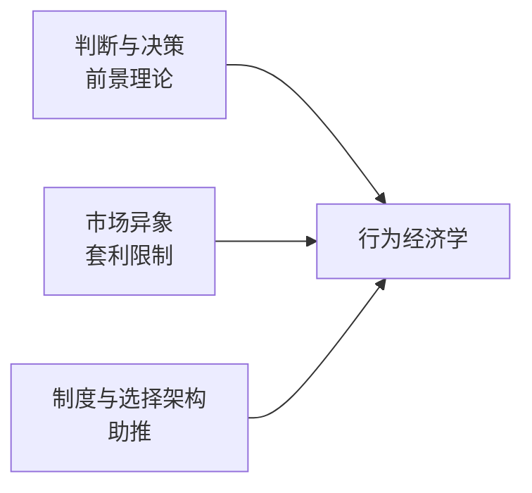

# 从理性人到行为经济学：三条脉络

> 行为经济学不是一次灵感，而是判断与决策、市场异象、制度与选择架构三条脉络从不同方向汇成的河流。

**模块：** 00  **讲次：** 02  **类型：** Learn
**前置：** 00-01  **预计时间：** 45–60 分钟
**AI 生成提示词：** gen-prompt.md

## 学习目标

1. 能按问题把行为经济学的三条脉络分开，并说出每条脉络的代表性发现
2. 能说明前景理论为什么是"描述性"理论，它与期望效用理论的差别在哪
3. 能区分"发现异象"与"解释异象为何不消失"，并说出套利限制在其中的作用
4. 能判断一个干预（如默认值、损失框架）落在三条脉络的哪一块，并说出它依赖的心理机制

## 问题背景

你第一次认真打听"行为经济学"是什么，大概会收到三个互相打架的答案。有人说它的起点是 1979 年那篇讲"前景理论"的论文，因为它第一次系统说明人怎么评价得失；有人说是股票市场里那些反复出现、标准模型解释不了的价格模式；还有人说是"把默认值一改、行为就变"的那种政策技巧。三个答案听起来不像在讲同一个东西，可它们确实属于同一门学问。

先看一个老问题。同一个人，会排队买保险，也会排队买彩票。保险是花钱把风险转移出去，彩票是花钱把风险揽上身；从期望值的角度看，这两件事的方向恰好相反——买保险时他厌恶风险，买彩票时他偏好风险。如果一个人脑子里有一张固定的"风险态度表"，这些选择本该是矛盾的。Kahneman 与 Tversky 在 1979 年正是抓住这一点：他们发现，用一条对财富水平而言凹或凸的效用曲线，无法同时解释这两种行为；人评价的其实是"相对某个参照点，我是赚了还是亏了"，而且对损失的敏感度远高于对同等收益的敏感度。

再看另一个方向的发现。一个国家的器官捐献同意率可以高达九成以上，另一些国家却只有一成上下，差距大到不可能用文化或教育单独解释。Johnson 与 Goldstein 在 2003 年指出，真正的分界往往是登记表上的那一格：默认勾选"同意"的国家，同意率就高；默认要求本人主动勾选的国家，同意率就低。这里没有改变任何激励——没有奖励、没有惩罚、没有价格，只是改了"什么都不做时会发生什么"。

三条线索，其实在回答三个不同层次的问题：**人怎么评价一个结果（判断与决策）**、**这些评价在市场上会不会留下痕迹（异象与套利限制）**、**制度能不能把这些规律用起来（选择架构与助推）**。本讲的任务，就是让这三条线各自归位，然后看它们如何汇成同一个研究纲领。

## 核心概念

先把"标准答案"摆出来，再讲它被改成了什么。

**先给直觉。** 面对一个有风险的选项，人们习惯按"平均能拿多少"来判断好坏；期望效用理论把这种直觉形式化：给每个可能结果配一个满足程度（效用），再按它发生的概率加权求和。它给了经济学一把尺子，使"风险下的选择"可以写成一道最优化题。

- **期望效用理论**：在不确定性下，按各结果效用的概率加权之和来做选择的理论，是风险决策的基准模型。它不描述人脑内发生了什么，只提供一个"理性应该怎么选"的标尺。
- **前景理论**：用参照点、损失厌恶与概率加权来描述风险下**实际**选择的描述性理论。它有三处对期望效用的关键改动：价值对着参照点定义、按盈亏而非绝对财富衡量；损失比同等收益更扎人；小概率被高估、中高概率被低估，而不是按真实概率加权。

**再给一件具体的东西。** 一位消费者面对两款保险：A 自付额高、保费便宜，B 自付额低、保费贵。按期望效用，他应该比较两者的期望成本与自身财富的效用。但现实中，他还会被"万一出事"这个小概率事件牵着走——前景理论预测，他会给这个小概率的坏结果加上一个超出其真实概率的权重，于是偏向那份"更省心"的保险。这正是期望效用与前景理论会在同一份数据上给出不同预测的地方。

把视角从个体拉远，就出现另外几个术语：

- **市场异象**：难以用理性与有效市场假设解释、却稳定重复出现的价格或行为模式。它是对基准模型的实证挑战，不是一份反例清单。
- **套利限制**：使理性交易者无法或不敢纠正错误定价的现实约束，如风险、交易成本与制度限制。它解释了异象**为什么能活着**。
- **助推**：不禁止选项、也不改变价格，只调整选择的呈现方式以引导更好选择的干预。
- **选择架构**：选项被组织、排序与描述的方式，包括默认值。它系统性地改变选择，尽管不改变任何成本。

三条脉络的关系可以用一张图说清：

需要早点点明的，是**有限理性**这个概念。它不是说人笨，而是说人的信息与计算能力有限，因此追求的是"足够好"而不是最优。前景理论描述的偏差、市场异象，以及默认值的效果，都可以看成同一个前提在三处结出的不同果实：**人在约束下的确会最优化，但只对眼前、显眼、算得动的那部分最优化。**

## 经济学视角

经济学在这里承担三件事：给标尺、给市场、给检验。

**给标尺。** 期望效用理论是风险决策的原点。它把"选哪个"变成"算期望效用然后取最大"，于是任何一个被认为不理性的选择，都可以翻译成"哪一步的假设被违反了"。这一步翻译很关键：没有标尺，就没有"异象"这个词。

**给市场。** 经济学的核心工具是**套利**与**均衡**。当一个价格偏离了理性基准，套利者会买入被低估的、卖空被高估的，从中获利，同时把价格推回原位。掌握这个机制，你就能把"异象"变成一个有方向的预测：**可以被套利的异象，应该很快消失；能长期存在的异象，背后一定有套利限制。** 这就是第二条脉络的全部逻辑骨架。

**给检验。** 有效市场假设给出一个可证伪的基准：如果价格已经反映了所有可得信息，那么基于公开信息的策略不该稳定赚钱。异象研究的工作方式，就是不断拿真实价格数据去撞这块基准，看它在哪儿裂开。裂开的地方往往不是"经济学错了"，而是**定价机制里有一处被模型省略的摩擦**——流动性、卖空限制、交易成本。

有一个区分要在这里立起来：**期望效用是"应该怎么选"的标准，前景理论是"实际上怎么选"的描述。** 前者不需要在每个细节上像人，后者也不需要成为一条普遍公式。把它们的关系理解成"新理论取代旧理论"，恰恰是下一条常见误区的根源。

## 心理学视角

心理学在这条线上承担另外三件事：给机制、给形状、给边界。

**给机制。** 前景理论的三个部件都是心理机制，不是数学玩具。**参照点**说明人评价的是"相对于某个基准的变化"，而不是绝对水平；**损失厌恶**说明同等金额的得失在心理上不对称，这解释了为什么人会既买保险又买彩票——买保险是消除一个损失的可能，买彩票是买一个"从参照点往上跳"的机会；**概率加权**说明人对小概率事件的处理偏离真实比例，这解释了对低概率风险的过度反应。

**给形状。** 心理学最不可替代的贡献，是指出偏离有**方向**。只说"人不理性"没有信息量；说"损失比同等收益的权重要大、小概率会被高估"才能生成可检验的预测。

**给边界。** 心理学的方法论提醒我们，效应量随情境、人群与测量方式大幅波动。**没有幅度的方向，无法用于决策。** 这一点在《经典研究》一节会看得更清楚：前景理论是描述性的基石，但它的参数从来不是常数。

心理学的短板同样要说清：它擅长实验室里控制良好的选择，却**不负责聚合**。一个实验室里成立的编码规则，放进有竞争、有套利的市场之后会变成什么样，是经济学的问题，不是心理学能单独回答的。

## 交叉洞察

三条脉络真正的共同结构，是**分工**加**张力**，而不是"心理学管个体、经济学管市场"式的并列。

**分工。** 心理学给出**选择的形状**：人围绕参照点编码得失、对损失更敏感、对小概率过度反应。经济学给出**聚合与检验的机器**：把这些形状放进一个有套利、有竞争、有学习、有退出的市场，问它们会留下什么痕迹。第一条脉络是这一步的前半；第二条脉络就是这一步本身——异象是否存在、能否存活，全看套利能不能把它抹平。第三条脉络则反过来：如果套利抹不平，制度能不能改一改。**三条线是同一条流水线的三段：描述 → 检验 → 应用。**

**张力。** 张力至少有三处，每一处都是本讲要你带着走的警惕。

第一，**描述与规范不能互换。** 前景理论描述了人怎么选，但它不构成"应该怎么选"的标准。用它去论证某个政策"天然合理"，等于从"人就是这样"跳到"这样是对的"，中间缺了一步论证。

第二，**参数不稳定，是这条路线的常态而非意外。** 损失厌恶的方向被反复观察到，但它的强度随情境波动很大，近年有元分析与可复制性研究对它被广泛引用的量级提出批评。这意味着：拿一个漂亮的实验室效应量去乘人口规模，是最常见的过度外推。**方向可以生成假设，幅度必须实测。**

第三，**制度既能纠偏，也能被滥用。** 同一个选择架构工具，既可以帮人存下养老钱，也可以被用来诱导透支或延长续费。工具本身不含价值判断，它的用途取决于谁在设计、为谁设计。这也是为什么第三条脉络从一开始就带着伦理争论，而不只是效果争论。

一个可以随身携带的判据是：碰到任何"心理规律改变行为"的说法，先问它落在三条脉络的哪一段——**只是发现了一条描述性规律，还是证明了它在市场里存活，还是已经把它装进了制度。**

## 现实案例

1. **同一个人既买保险又买彩票。** 这是风险决策文献里被反复讨论的经典观察：保险是花钱转移风险、彩票是花钱承担风险，两者方向相反，却常出现在同一个人身上。Kahneman 与 Tversky (1979) 用它来说明，一个统一的、对财富水平定义的风险态度无法同时容纳这两种行为；必须引入参照点与概率加权——人不是在评价"总财富是多少"，而是在评价"相对于某个基准，我可能往上跳一步（买彩票）还是往下掉一截（不买保险）"。这个案例的可核查之处，在于它直接指向那篇公开论文里的具体论证。（本课关心的是机制，不复述原文的拟合参数。）

2. **器官捐献登记表的默认选项（Johnson & Goldstein, 2003，*Science* 302(5649)）。** 该研究比较了不同国家的器官捐献登记制度，发现同意率的高低与登记表的设计高度相关：默认"同意、可退出"的制度下同意率高，默认"需主动勾选"的制度下同意率低。它属于第三条脉络——制度与选择架构：这里没有取消任何选项、没有改变任何价格，只是改变了"什么都不做时会发生什么"。它的作用机制，正是现状偏好与惯性：多数人会停留在默认位置上，而不是主动计算后做出选择。（本课引用其方向与机制，具体数值请查原文。）

## 常见误区

1. **误区：行为经济学就是"反理性"，是给理性模型挑毛病。**
   错在哪：把态度当成了内容。行为经济学并不否认人会对激励做出反应，它只是拒绝"人总是按期望效用计算"这一条额外假设。
   正确的说法：它是一条把**描述性**假设装进**聚合**框架的研究纲领。它对理性模型的态度是"划出适用范围"，而不是"证明它错"。

2. **误区：前景理论已经"推翻"了期望效用理论。**
   错在哪：混淆了描述与规范，也混淆了"基准"与"竞争理论"。期望效用仍是分析风险决策的规范基准，许多推理链条仍从它出发。
   正确的说法：前景理论是**更贴近实际选择**的描述性理论，它在参照点、损失与概率的地方修正了期望效用的假设；两者可以并存，一个管"应该"，一个管"实际"。

3. **误区：只要能指出一个心理偏差，就能解释一个市场现象。**
   错在哪：跳过了聚合。偏差要在市场上留下痕迹，必须穿过套利、竞争、学习与退出这几道工序；很多偏差在反馈快、可套利的市场里会被磨平。
   正确的说法：先把偏差放进市场结构里检验它能否存活（第二条脉络），再考虑它是否需要制度去应对（第三条脉络）。**发现偏差只是第一步。**

## 经典研究 5 分钟摘要

- **作者/年份**：Kahneman, D. & Tversky, A. (1979)，《前景理论：风险下决策的分析》，*Econometrica* 47(2)。
- **结论**：人不是按期望效用评价风险选项的。选择围绕**参照点**组织，结果被编码为收益或损失；**损失**被赋予比同等收益更大的心理权重；对**概率**的感知是非线性的，小概率被高估、中高概率被低估。这三点合起来，系统性地违反了期望效用理论。
- **争议**：第一，它是**描述性**理论，不是万能公式——它描述人在受控情境下怎么选，不直接给出政策处方。第二，**损失厌恶的量级**与部分参数受到元分析与可复制性研究的批评，其经典数值被指普遍高估，且随情境与测量方式大幅波动。第三，**外部效度**受情境限制：实验室里稳定的效应，进入有竞争与套利的真实市场后，强度可能被显著削弱。

## 自测题

1. 一个人同时买医疗保险和买彩票，把这两种偏好放在一起，最该让你想到什么？
2. 期望效用理论在风险决策里扮演的是什么角色？
3. 前景理论相对期望效用理论，最主要的改动是什么？
4. 为什么某些"市场异象"能长期存在而不被抹平？
5. 一家机构把养老金计划的默认选项改成"自动加入、可随时退出"。这属于三条脉络中的哪一块，靠什么机制起作用？
6. 有人读到"损失比收益更扎人"，就主张给某项政策加一个"损失框架"来推动人群改变。这个推断最该被质疑的地方是什么？

## 延伸关键词

期望效用理论、前景理论、有限理性、市场异象、套利限制、助推、选择架构、参照点、损失厌恶、行为经济学