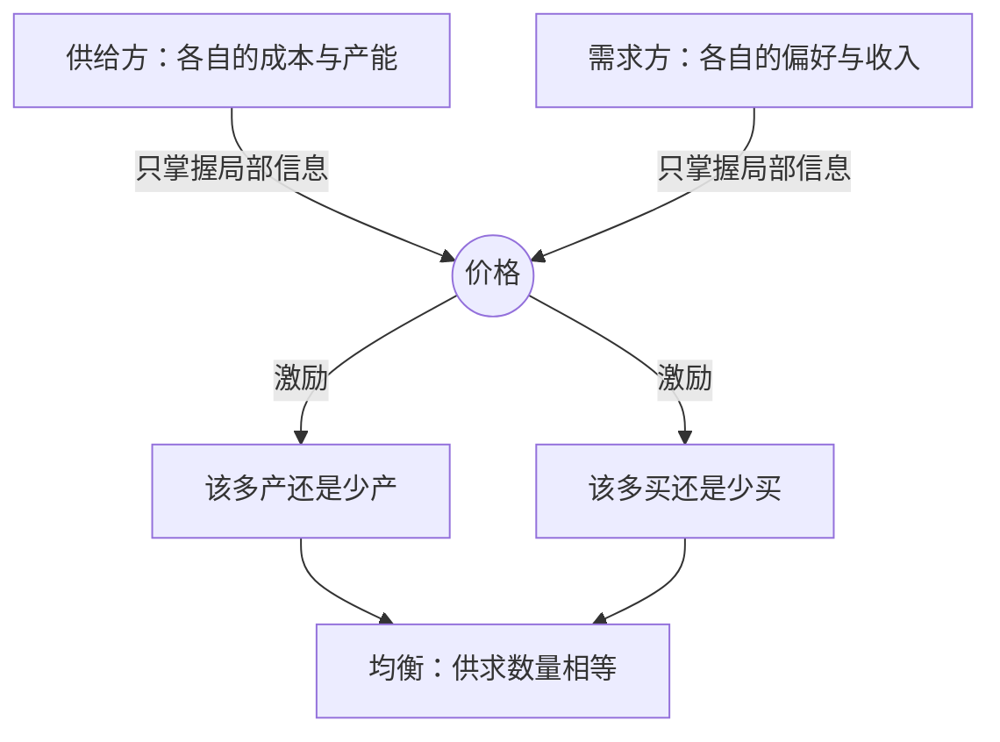

# 需求与供给：价格如何传递信息

> 价格不是一串冷冰冰的数字，而是把分散信息压成可读信号的载体；需求与供给在它上面相遇，协调了谁也不掌握全局的无数决定。

**模块：** 01  **讲次：** 03  **类型：** Learn
**前置：** 01-01、01-02  **预计时间：** 45–60 分钟
**AI 生成提示词：** gen-prompt.md

## 学习目标

1. 能用自己的话说清需求与供给各自描述的是"价格与数量之间的关系"，而不是某个固定数量
2. 能区分"沿曲线移动"与"整条曲线移动"，并判断一个事件改变的是哪一个
3. 能说明价格作为信息载体与激励信号的双重角色，以及"看不见的手"在什么前提下才成立
4. 能用双重拍卖的实验结果解释：为什么个体只掌握局部信息，市场却可能收敛到均衡价格

## 问题背景

设想一个再普通不过的场景：一座城市里有一百万户家庭要在同一周决定买多少鸡蛋。没有人在中央下达命令，没有人知道别人会买多少，每个养鸡场也只大致知道自己能供多少。可是到周末，超市货架上的鸡蛋既没有堆到腐烂，也没有被抢空——价格稳在了某个数上。更耐人寻味的是，如果爆发禽流感，几周之内鸡蛋就会涨价，家庭自动少买一点、转向鸭蛋和豆制品，千里之外的养殖场则因为看到高价而增加补栏。整个过程里，没有任何一个人掌握全局。

这里同时藏着两件常被混淆的事。第一，价格是一张**信号**：它把分散在千百万人手里的局部信息——谁多想要一点、谁还能多供一点——压缩成一个可以比较的数字。第二，价格是一种**激励**：它改变了每个人自己的成本收益计算，于是自利的行为被引导到"该少买的人少买、该多产的人多产"的方向上去。信号让信息可读，激励让行为改变；缺了任何一半，协调都不会发生。

但价格从来不只是效率工具。禽流感之后鸡蛋涨价，养殖户多赚了钱，而预算紧张的家庭承受了实实在在的负担。涨价传递了"该少买、该多产"的信息，却不询问任何人的意愿，也不会自动照顾谁。这引出本讲真正的张力：**价格是一种协调机制，而不是一种评判机制。** 它能高效回答"资源该往哪走"，却回答不了"这样的分配公不公平"。经济学与心理学恰好抓住这件事的两面，这一点后面会展开。

## 核心概念

先纠正最容易被误解的一点：**需求不是"人想要多少"，而是"在不同价格下，人愿意且能够买多少"这组对应关系。** 你说"我想要一辆车"，这只是愿望；"只要价格低于十万我就买"才是需求的一部分。正因为它是"价格—数量"的对应，经济学才能把需求画成一条曲线，回答"如果价格是这么多，会买多少"这类可以推导的问题。

供给是对称的：**供给不是"现在有多少货"，而是"在不同价格下，生产者愿意且能够卖多少"这组关系。** 价格高，原本不划算的产能也被激活，愿意出售的数量随之增加。把两条关系放在同一张图上，就得到本讲最核心的两个经验规律：

- **需求定律**：其他条件不变时，价格上升，需求量下降。它背后是**替代效应**（鸡蛋贵了就转向鸭蛋）与收入效应（同样的钱能买到的东西变少）。
- **供给定律**：其他条件不变时，价格上升，供给量上升，因为更高的价格让生产更有利可图。

两条曲线相交的地方就是**均衡**：在这个价格上，想买的数量恰好等于想卖的数量，市场既不明显短缺也不明显过剩。这个价格没有被人设定，它是无数独立决定碰到一起的结果。亚当·斯密把这种由私利驱动、经市场协调、产生非本意公共好处的机制称为**看不见的手**。

用一句话把上面的概念串起来看价格如何传递信息：

一个例子收束本节：一场台风袭击了沿海叶菜产区，蔬菜变少。在需求不变的情况下，均衡价格上升、成交量下降。这里的关键是，涨价不是某个人"决定的"，而是失衡在价格上的体现；同时它自动完成两件事——让本地消费者少买一点，也让外地货源觉得有利可图，把菜运进来。价格没有说一句"请节约"，却让千万人各自调整了行为。

最后必须加一句限定：需求定律和供给定律都带着"其他条件不变"这个前提。一旦收入、偏好、技术或相关商品的价格发生变化，**整条曲线会移动**，而不是沿着曲线滑动。把这两种移动混为一谈，是初学者最常犯的错误，见《常见误区》。

## 经济学视角

经济学在本讲里提供三件工具：一张图、一种比较方法、一个关于"谁在做决定"的说明。

第一件工具是**供求图**。它把"某个事件会造成什么后果"变成一道可推导的题：先判断事件冲击的是需求侧还是供给侧，再决定曲线往哪边移，最后读出均衡价格与数量会怎样变化。这套流程之所以有用，是因为它几乎不需要知道任何人的偏好细节——只需要知道哪一侧、往哪个方向。

第二件工具是**比较静态分析**。我们不追踪市场如何一步步挪到新均衡，只比较"冲击之前"和"冲击之后"两个均衡的位置。这种"跳过过程、只比两端"的做法，正是经济学能处理复杂市场的秘诀；代价是它不告诉我们调整要花多久（那是 01-05 讨论弹性时要补上的）。

第三件、也是最容易被忽略的一件，是经济学明确告诉你**谁来协调**。需求方的每个人只看自己面对的价格与收入，据此权衡**机会成本**；供给方的每个人只看自己面对的价格与成本，据此比较**边际成本**。没有人需要知道别人的偏好或产能，价格就把这两组局部信息耦合到了一起。这正是经济学最反直觉、也最有解释力的地方：**协调可以不需要全局信息，也不需要善意。**

## 心理学视角

心理学在本讲里至少补三样东西。

第一是**价格感知**。价格不是一个被客观读取的数字；人判断"贵不贵"依赖**参照点**与锚定。"原价 999、现价 599"之所以有效，是因为它先给你一个参照点，再让你在这个参照点上感受落差。经济学模型里没有"原价"的位置，只有此刻的真实价格。

第二是**公平感**。灾害后涨价在很多人眼里不是"供需信号"，而是"趁火打劫"。这背后是**社会规范**与公平判断：同样的涨价，若被讲成"运输成本上升"，接受度会高一些；若被讲成"借机牟利"，就会被抵制。这种反应会真实地进入行为——投诉、拒买，乃至推动立法（见《现实案例》第二条）。它意味着价格能不能"顺畅地传递信息"，本身取决于人怎么解读它。

第三是**注意力有限**。人不比较所有价格，只比较显眼的少数几个。货架上被突出的那格、结账时弹出的小字、被反复念叨的"标杆价"，会获得不成比例的权重。**注意力有限**让"把某样东西放进视野"本身成为一种影响需求的手段——不需要改变任何真实成本。

## 交叉洞察

这一节不能写成"经济学看机制、心理学看感受"的并列，真正的结构是**分工**加**张力**。

**分工。** 经济学给出"价格如何协调"的机制：两条曲线、一个均衡、一套比较静态。心理学给出"人如何读这个价格"的过程：参照点决定贵不贵，公平规范决定该不该接受，注意力决定先比较哪个。价格机制假设人对激励有反应，心理学则具体回答——人们对什么样的价格、带着什么样的参照点和公平判断做出反应。前半句是经济学，后半句是心理学，合起来才是完整的图景。

**张力。** 本讲最要紧的一句话是：**价格传递的信息是真的，但人未必照着读。** 经济学说价格上升会抑制需求，这在总体数据上通常成立；但在个体层面，人们对涨价的第一反应可能是愤怒而非调整，对"原价打折"的第一反应可能是"划算"而非比较绝对价格。于是同一个价格信号，在总体层面被平滑吸收，在个体层面却被公平感、参照点和注意力扭曲。这道分歧是最有价值的研究入口：市场用"总体行为到底有没有调整"来检验价格机制，心理学用"个体为什么这样判断"来解释调整的方向和幅度为何会偏离。

由此得到一个可操作的判据：如果一个市场的价格变化频繁、竞争激烈、消费者反复购买且能看清真实价格（比如菜市场的日常蔬菜），价格信号会被顺畅读取；如果价格被锚定、被框架、被公平规范包裹（比如灾后限价、被"原价"包装的促销），调整就会被延迟甚至被抑制。后面讲弹性（01-05）时，正是这道闸门决定了税收和限价政策的后果落在谁身上。

## 现实案例

1. **2000 年代国际油价上涨与美国汽油需求的变化。** 2000 年代原油价格进入持续上行通道，到 2008 年前后达到高点。按需求定律，汽油消费会随之调整：单次行驶里程下降、更省油的车更受欢迎、公共交通使用增加。公开的能源统计（如美国能源信息署 EIA 的公开数据）显示，美国汽油消费在高油价阶段确实放缓了增长。本讲只写这条方向与机制，不引用未经核实的具体弹性数值——精确数字请以能源统计机构的公开口径为准；汽油需求到底有多不敏感，是 01-05 的主题。

2. **灾害后的"反哄抬价格法"与短缺。** 美国多数州都有反哄抬价格法（anti-price-gouging laws），在飓风等灾害后限制对汽油、水电等必需品的定价，违规涨价会受处罚。用本讲的供求分析看：限价相当于给价格装了一个天花板，价格无法上涨，就无法把"该多供应"的激励传给外地货源与本地存货持有者，也无法抑制抢购，于是**短缺可能被延长甚至加剧**。这是经济学教科书式的机制推断。需要显式标注**争议**：支持这类法律的声音认为，灾后短期市场本身可能失灵（恐慌、哄抬），维护基本公平的收益大于效率损失，且"趁机暴利"会侵蚀社会信任。因此，"限价导致短缺"是机制上的强预测，但它值不值得用公平与信任去交换，是一个规范性判断，不属于本讲的实证部分。

## 常见误区

1. **误区：把"需求下降"和"需求量下降"当一回事。**
   错在哪：前者是整条需求曲线左移（比如收入下降、偏好改变），后者是价格变化导致沿同一条曲线滑动。这两个词听起来只差一个字，图上的动作却完全不同。
   正确的说法：先问"什么变量变了"。只有价格变，才谈"沿曲线移动"；收入、偏好、技术、相关商品价格变，谈"整条曲线移动"。

2. **误区：均衡价格就是"公平价格"或"正确价格"。**
   错在哪：均衡只说"供求相等、没人愿意单方面改变"，它不包含任何道德评价。灾后涨到高位的价格可以是均衡，却可能让人难以接受。
   正确的说法：均衡回答的是"资源会流向哪里"，公平回答的是"这样的分配是否可以接受"。这是两个问题，需要两套不同的论证（经济学管效率，规范判断管公平）。

3. **误区：价格上一定是"卖方垄断"或"奸商"造成的。**
   错在哪：价格由供求两侧共同决定。产地受灾、需求骤增，都足以在竞争充分的市场里推高价格，不需要任何垄断者。把涨价一律归咎于卖方，会误判成因，也会导向错误的政策。
   正确的说法：先看是供给曲线左移还是需求曲线右移（或两者同时），再判断是否存在市场势力。识别成因，才能判断该不该干预、干预什么。

## 经典研究 5 分钟摘要

- **作者/年份**：Smith, V. L. (1962), "An Experimental Study of Competitive Market Behavior"，《政治经济学杂志》（*Journal of Political Economy*）70(2)。
- **结论**：在双向拍卖（double auction）实验市场中，买卖双方只掌握关于自己成本或价值的局部信息，连续公开报价并撮合成交；结果是成交价与成交量逐步收敛到竞争均衡的预测。也就是说，参与者不需要知道全局、也不需要算出均衡价，市场制度本身就能把交易拉向均衡。
- **争议**：第一条是**外部效度**——实验室市场规则清晰、人数有限、时段很短，其结论能否推广到规则复杂、参与人高度异质、充满制度摩擦的真实市场，仍有讨论。第二条是**边界条件**——收敛并非在所有交易制度下都出现；哪些报价规则、参与者规模与信息结构能产生收敛，是后续实验研究持续在测的问题。因此"市场会收敛到均衡"是一个有条件的经验命题，而非无条件的定律。

## 自测题

1. 一个没有政府干预的市场，某类商品因产地受灾而突然变少。凭直觉判断：接下来最可能发生什么？
2. 下面哪种情况会使需求曲线整体移动（而不是沿着它移动）？
3. 本讲说价格同时是"信号"与"激励"。哪一句最能说明价格作为信号的作用？
4. 需求定律（价格上升、需求量下降）在经济学里主要靠哪两种效应解释？
5. 某地遭飓风后政府依法对汽油等必需品限价、禁止涨价。按本讲的供求分析，最可能出现什么结果？
6. 在一个双向拍卖实验市场里，每个交易者只知道自己的成本或价值。根据本讲引用的实验研究，通常的结果是什么？

## 延伸关键词

需求、供给、需求定律、供给定律、价格机制、看不见的手、双重拍卖、均衡