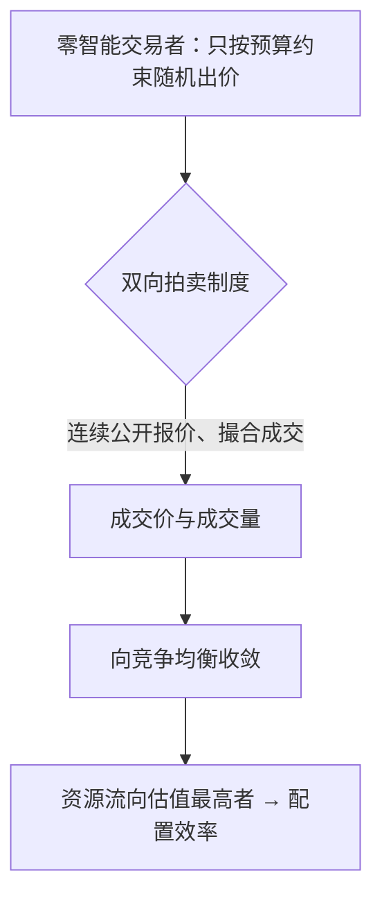

# 均衡与市场出清

> 均衡是没人愿意单方面改变的状态；效率可能来自市场制度本身，而不必假设每个人都在做最优计算。

**模块：** 01  **讲次：** 04  **类型：** Learn
**前置：** 01-03  **预计时间：** 45–60 分钟
**AI 生成提示词：** gen-prompt.md

## 学习目标

1. 能用自己的话解释"均衡"为什么是一个"解概念"，而不是对市场运行过程的描述
2. 能区分市场出清、竞争均衡与配置效率这三个相关但不相同的概念
3. 能说明"零智能交易者"实验为什么动摇了"效率必须来自个体理性"这一直觉
4. 能用制度设计的视角解释：为什么改善市场结果可以从改规则入手，而不只靠要求个体更理性

## 问题背景

凌晨的渔市是观察"均衡"的好地方。渔船陆续回港，货还湿漉漉地躺在箱子里，没有人知道今天到底该卖多少钱。买家在一排排摊位之间走动，摊主不断改口报价；到某个时点，价格稳住了，想买的买到了，想卖的卖掉了，剩下的鱼不多不少。**没有任何人算出了这个价格，它却出现了。**

这引出一个反直觉的问题：价格要"稳住"，是不是意味着每个人都得精确地算出自己的最优买卖量？按字面理解，**均衡**的定义是"每个人各自最优，且没有人愿意单方面改变自己的选择"。看起来，要达到这个状态，参与者必须先把整张供求表算清楚——而这显然不是凌晨渔市里发生的事。

01-03 讲了供求两条曲线与它们的交点。本讲要往下追问一层：这个交点究竟意味着什么？它是"人人事事最优"才会出现的脆弱巧合，还是一种由**市场制度**自动促成的结果？这个区别不只是理论趣味，它决定了我们该去优化"人"，还是去优化"规则"。

有一个实验结果把这个问题推到了台前。研究者造了一批完全不做最优化、只按预算约束随机出价的虚拟交易者——**零智能交易者**——放进双向拍卖市场，想看看没有"聪明人"会不会就没有效率。结果出乎直觉：效率并没有崩塌。本讲接下来的内容，就是围绕"效率到底从哪来"展开。

## 核心概念

先把四个容易混在一起的概念摆清楚。

**均衡**，本讲的核心。它不是"价格最高的点"，也不是"所有人都满意"，而是：**每个人各自最优、且没有人愿意单方面改变自己的选择**的状态。关键要记住，均衡是一个**解概念**——它描述"什么样的结果是稳定的"，而不描述"市场怎样一步步走到那里"。就像棋局的均衡只说明双方都不愿换招，不说明他们是怎么下到这一步的。

**市场出清**，是均衡在价格上的具体表现：在某个价格下，想买的数量恰好等于想卖的数量，既没有明显的短缺，也没有明显的过剩。它回答的是"这一种商品的价格稳不稳"。

**竞争均衡**，是把市场出清推广到所有市场同时成立：在完全竞争的设定下，所有商品的价格与数量同时出清。它是一种整体性的价格—数量组合。

**配置效率**，是评价结果好不好的标准：资源流向估值最高的使用者，总剩余达到最大。请注意，配置效率讲的是"蛋糕做多大"，与"蛋糕怎么分"是两件事。

把供求图放回渔市，就能看到这几个概念如何咬合：

**零智能交易者**因此成为一个关键装置：它把"最优化能力"从交易者身上拿走，只留下预算约束，用来检验一件事——效率是否真的依赖个体的理性。答案是：很大程度上不依赖。效率来自**拍卖市场**这套制度本身——报价规则、信息揭示方式与撮合机制。同一批"零智能"的交易者，换一种报价规则，结果就可能不同。这就把问题从"人够不够聪明"转到了"制度够不够好"。

最后引入**聚合**：把个体的行为汇总成总体结果的过程。均衡、出清、配置效率，都是聚合层面的概念；它们不能从单个交易者的行为里直接读出，必须经由制度这台机器。

## 经济学视角

经济学在本讲提供两样最有力的东西：一个可以当作基准的**解概念**，和一套关于**福利与效率**的评价工具。

**均衡作为解概念**，作用类似于物理学里的参照系。它让我们可以先问"如果市场达到稳定，会稳定在哪里"，再去讨论现实偏离了多少、为什么偏离。更进一步，把均衡理解成"没有人愿意单方面改变"，就把它和**博弈**打通了：纳什均衡、囚徒困境都是同一个思路的产物（01-07 会展开）。

**配置效率与总剩余**，给经济学提供了回答"好不好"的尺子。度量方式是边际的：只要还有一个人对某单位的评价高于另一个人的成本，把这一单位从他手里转到对方手里就能增加总剩余；配置效率就是这种"再没有改进余地"的状态。经济学由此得到一条经典结论（福利经济学第一定理的通俗版）：**在完全竞争且不存在外部性等摩擦的条件下，竞争均衡是配置效率的。** 要注意这句话有前提，前提一旦破了，结论就不保证成立——这正是 01-09、01-10 要处理的题。

还有一条被本讲强调的推论：**制度设计（机制设计）**是经济学的一门硬功夫。既然效率来自规则，那么规则就可以被设计得更擅长发现价格、抑制串通、诱导真实报价。这不是修辞，而是有实际应用的工程（见《现实案例》第一条）。

## 心理学视角

心理学在本讲承担的，恰好是给"人人最优"这个假设泼冷水，同时解释为什么市场还是能稳下来。

第一，**人并不是最优计算器**。在不确定下，人使用的是**启发式与偏差**——简化的判断规则，它们快速、通常够用，但会系统性地偏离最优。此外，**注意力有限**，人只盯住少数几个显眼的信息；手里握着一堆复杂计算的人，实际上靠的是几条粗糙的规则。

第二，正因为个体用的是粗糙规则，市场的结果才更需要制度来解释。**聚合**的过程会把大量带有噪声的局部规则汇总起来：有些偏离互相抵消，有些被竞争筛选掉，剩下的被价格吸收。于是市场看起来"像一个理性人"，而参与其中的每个人都不是。这就是"as if（仿佛）理性"的真正含义——不是假设人是理性的，而是说聚合结果**仿佛**由理性产生。

第三，心理学还提醒我们，个体偏离的方向并非随机，因此制度如果放在错误的决策点上，聚合就不会自动纠偏。**社会规范**、从众、以及对"公平"的判断，会让某些报价规则下的行为集中到同一个方向，反而放大偏差。落到拍卖场景：信息披露方式、报价是否公开，会改变参与者的判断重心，从而改变效率。制度在这里不是背景，而是变量。

## 交叉洞察

这一节必须给出**分工**与**张力**，而不是"经济学看总量、心理学看个体"的并列。

**分工。** 经济学提供**均衡与效率的基准**，以及**制度如何塑造聚合**的框架；心理学提供**个体实际怎么决策**。经济学先问"稳定在哪里、效率如何度量"，心理学再追问"组成这个总量的个体，到底是靠什么规则走到那个点的"。只有前一半，会误以为均衡要靠人人心算；只有后一半，会停留在"人会犯错"却说不清这个错误会不会消失。

**张力。** 本讲最要紧的一句话是：**效率来自制度，而不是来自个体理性。** 这与 01-03 的直觉形成了一次反转——我们原以为"价格协调"是聪明人精算的结果，现在看到它可以由"零智能"加一套好制度实现。张力随之出现：

- 一方面，这**削弱**了"理性人假设"的必要性：效率不需要每个人最优，模型用理性代表总体结果，顶多是一种省略。
- 另一方面，它**抬高了制度的分量**：既然效率由规则决定，那么规则设计得差，再理性的参与者也可能达不到效率（拍卖规则糟糕，就会出现串通或报价失真）；规则设计得好，即使个体只是随机出价，也能逼近效率。
- 于是问题从"该优化谁"重新分配：**与其一味要求个体更理性，不如先把制度设计对。**

必须同时记住一条边界：配置效率不等于公平。一个市场可以既出清、又有效率，却把绝大部分剩余给了少数人。均衡"没人想单方面改变"也绝不等于"人人都满意"——不满意但无力改变，同样是均衡。

## 现实案例

1. **美国 FCC 频谱拍卖（1994 年起）。** 无线电频谱是稀缺公共资源，早期美国政府用行政比较听证来分配，效率低下、过程漫长。1993 年立法授权美国联邦通信委员会（FCC）改用竞争性拍卖分配牌照，FCC 自 1994 年起实施同步多轮拍卖等机制，其规则由一批经济学家参与设计（McAfee、Milgrom、Wilson 等，Milgrom 与 Wilson 获 2020 年诺贝尔经济学奖，主要贡献即拍卖理论）。这个案例的要点不是某个数字，而是它证明了本讲的主张：**当规则被精心设计，拍卖能同时发现价格、减少串通、把频谱分配给估值最高的使用者；而规则一旦设计不当，同样的参与者也可能给出糟糕的结果。**

2. **证券交易所的连续竞价与集合竞价。** 交易所有两种基本撮合方式：**连续竞价**是每一笔委托到达就立即与对手方撮合成交；**集合竞价**是把一段时间内的所有委托集中起来、在同一时点一次性撮合出统一价格（沪深市场的开盘、收盘即采用集合竞价，纽约证券交易所的开盘与收盘也有类似的集中撮合安排）。同一群人、同一只股票，换一种撮合规则，价格发现的节奏与稳定性就可能不同：连续竞价随时成交、流动性即时但有波动；集合竞价在时点上集中成交、单点价格更稳。这个对照说明，**效率与价格质量不只取决于参与者，也取决于制度如何组织他们。**

## 常见误区

1. **误区：均衡意味着分配公平，或者大家都满意。**
   错在哪：把"稳定"当成了"好"。均衡的全部含义只是"没有人愿意单方面改变"，一个人可以很不满意却无力改变，这依然是均衡。
   正确的说法：均衡回答"结果稳不稳"，配置效率回答"蛋糕做多大"，公平回答"蛋糕怎么分"。三者是三个问题，需要三套不同的论证。

2. **误区：市场有效率，说明参与者是理性的、都在做最优计算。**
   错在哪：把总体层面的性质直接安到个体身上，跳过了聚合。零智能交易者的实验说明，效率可以来自制度，参与其中的每个人都可以完全不做最优化。
   正确的说法：市场"仿佛"理性，指的是聚合结果像理性产生；这是制度的功劳，不构成对个体理性的证据。

3. **误区：只要让价格自由浮动，市场就一定达到配置效率。**
   错在哪：把有条件的结论当成无条件的定律。配置效率的经典结论依赖完全竞争、产权清晰、无外部性、信息充分等前提，现实中这些前提常常不成立。
   正确的说法：价格自由浮动是效率的**有利条件之一**，不是充分条件。当存在信息不对称、外部性或市场势力时，价格再自由也可能达不到效率——这是 01-09、01-10 的主题。

## 经典研究 5 分钟摘要

- **作者/年份**：Gode, D. K. & Sunder, S. (1993), "Allocative Efficiency of Markets with Zero-Intelligence Traders: Market as a Partial Substitute for Individual Rationality"，《政治经济学杂志》（*Journal of Political Economy*）101(1)。
- **结论**：作者把交易者替换成完全不含最优化、只按预算约束随机出价的"零智能"虚拟交易者，放进双向拍卖市场。结果显示，市场仍能达到接近完全理性交易者所能达到的配置效率。由此提出：**效率主要来自市场制度本身，而不是每个个体的理性计算**——市场是"个体理性"的部分替代品。
- **争议**：结论依赖双向拍卖这类特定制度。在其它报价与撮合机制下（例如信息披露受限、容易串通的规则），"零智能"未必产生同样的效率。因此"制度带来效率"是有限定条件的命题，不能不加检验地推广到所有市场；它也回答不了配置之外的公平问题。

## 自测题

1. 凭直觉判断：一个交易者只按随机规则出价、完全不做计算的市场，与一群精于最优化计算的人组成的市场相比，配置效率会怎样？
2. 下面哪一句是对"均衡"最准确的描述？
3. 经济学说的"市场出清"指的是什么？
4. 本讲说的"配置效率"，指的是哪种状态？
5. 某政府用拍卖分配稀缺的频谱牌照，但规则设计不当（允许串通、报价信息不透明）。最可能的结果是什么？
6. 本讲的核心结论是"市场的配置效率很大程度上来自制度而非个体最优化"。这个结论对"改善市场结果"意味着什么？

## 延伸关键词

均衡、市场出清、竞争均衡、配置效率、零智能交易者、拍卖市场、聚合