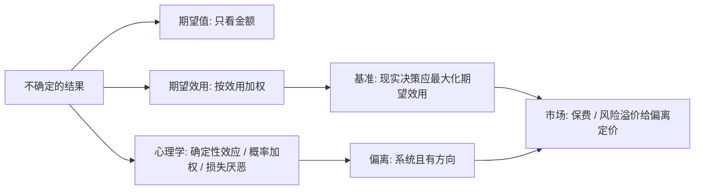

# 风险与期望效用

> 期望效用是风险决策的基准，而人对概率与得失的处理系统性地偏离它。

**模块：** 01  **讲次：** 08  **类型：** Learn
**前置：** 01-02  **预计时间：** 45–60 分钟
**AI 生成提示词：** gen-prompt.md

## 学习目标

1. 能区分「期望值」与「期望效用」，并说明风险决策为什么要用后者而不是前者
2. 能用风险厌恶、风险中性、风险偏好描述一个人对风险的态度，并解释它们如何影响保险需求与博彩需求
3. 能复述阿莱悖论的选择结构，并指出它违反了期望效用理论的哪条公理
4. 能用确定性效应与概率加权解释「既买保险又买彩票」这类看似矛盾的行为

## 问题背景

设想有人给你两个选择。**A：直接拿 5 万元。B：掷一枚公平硬币，正面得 12 万，反面得 0。** 先别急着选，算一下它们各自的"平均结果"：A 是 5 万；B 是 12 万的 50% 加上 0 的 50%，等于 6 万。如果一个人只关心期望值，B 明显更好，人人都该选 B。但把这道题拿去问一圈，你会发现相当一部分人反而选 A——他们宁愿要一笔少一点但确定到手的钱，也不愿为了多出来的 1 万期望值去承担一半归零的风险。这不是算术没学好，而是在做另一种计算。

上一讲我们把「边际」当成了取舍的基本单位：多一个单位带来的额外收益与额外成本。但边际思维处理的是**确定**的结果——你确切知道自己多消费一个单位会多得到什么。一旦结果本身变得不确定，这套工具就要升级：我们不能只比较金额，还要比较"这件事有多可能发生"以及"这个金额对我来说到底值多少"。

经济学很早就在想这件事。**期望值**把 1 万元永远当成 1 万元，可同样多出来的 1 万元，对不同处境的人意义并不相同：钱越多，多出的那一万元带来的满足越少（这正是 01-02 讲的边际效用递减）。把"金额"换成"满足感"再加权，就得到了**期望效用**——风险决策的基准模型。它的逻辑很干净：不确定性下的理性选择，应当最大化各结果效用的概率加权和。

问题出在这个基准的裂缝上。阿莱（Allais）在 1953 年设计的实验，就是要在期望效用理论自己的游戏规则里把它将一军：多数人在两组彩票之间的典型选择组合，无论怎样给不同金额赋效用值，都无法同时满足期望效用理论的要求。这里的失分不是"算错了"，而是**选择模式本身不自洽**——同一个人对两组结构上平行的彩票给出了互相矛盾的态度。

这就构成本讲要处理的张力：**期望效用是理解风险决策绕不开的基准，但一旦走进实验室和真实市场，人对概率与得失的处理就会系统性地偏离它——而且偏离不是随机噪声，它有方向、可预测。** 本讲的任务，是先把基准讲清楚，再讲清楚偏离的形状，最后看这两种描述在市场里如何相遇。

## 核心概念

先抛开公式，用日常语言说。面对一个不确定的结果，人实际上要做两件事：掂量每个结果对我有多重要，再估摸每个结果有多可能。期望值和期望效用，就是把这个直觉形式化的两种方式。

**风险**：结果不确定，但各种结果发生的概率**已知或可以估计**。掷硬币、买彩票、投保都属于这一类。它区别于"连有哪些结果、各有多大可能都不知道"的完全未知——那种情形本讲不处理，那是另一个决策领域。

**期望值**：把每个可能结果的金额乘上它的概率，再全部相加，得到的"平均金额"。掷硬币正面 12 万反面 0，期望值就是 6 万；一张两元彩票有百万分之一的机会中 100 万，期望值就是 1 元（低于票价）。期望值只认金额，不带任何主观色彩。

**期望效用理论**：同样是概率加权求和，但把金额换成**效用**——把"这个结果对我有多重要"折算成的数值。一个人不按金额大小、而按效用大小做选择。这是风险决策的基准模型：**理性选择 = 最大化期望效用**。

**风险厌恶 / 风险中性 / 风险偏好**：这是对"赌不赌"的态度谱系，由效用函数的形状定义。风险厌恶的人**宁要一笔确定的钱，也不要期望值相同或更高的赌局**；风险中性的人只看期望值，对确定与不确定无差别；风险偏好的人反过来，宁可去赌也不要等期望值的确定金额。多数人在损失情境里偏风险厌恶，在赌一把小钱搏大奖时又偏风险偏好——态度随情境变化，这是后文要解释的关键。

**阿莱悖论**：人们在两组彩票之间的典型选择组合，系统性地违反期望效用理论的**独立性公理**。独立性公理说：如果两个选项有某个共同部分，那么这个共同部分的存在不应改变你对两个选项的偏好排序。阿莱用一组精妙的彩票让多数人的选择违背了它。

**确定性效应**：相比概率的一次普通变化，人们**特别偏好把结果从「几乎确定」变成「确定」**。从 99% 到 100% 的心理分量，远大于从 98% 到 99%。这与"再确认一次就能拿满分"的心情是同一个机制。

**概率加权**：人并不按真实概率做决策，而是对概率做了一层心理变换——**高估小概率、低估中高概率**。彩票之所以有吸引力，很大程度上是因为中奖这个极小概率被高估了。

一个能把上面几条串起来的例子：同一个人，会为几千元的车险付保费（用一笔确定的小支出，消除一个低概率的大损失——风险厌恶加确定性效应），转身又去买彩票（为一个小概率的大收益下注——概率加权高估了那个小小概率）。按纯粹的期望值，两笔都不划算；按标准的期望效用，它们又似乎互相矛盾。概率加权给了这个组合一个统一的解释：**人对小概率的态度不是单一方向，而是取决于这个概率背后是损失还是收益。**

## 经济学视角

经济学在本讲里提供了三样东西：一把标尺、一套类型学、一批市场证据。

**一把标尺：期望效用。** 它把"风险决策"从"赌不赌"这种情绪化描述，变成一个可计算的最优化问题。经济学家用一条效用函数曲线概括一个人对风险的态度：曲线越"弯"（凹），风险厌恶越强。由此可以推出一系列可检验的预测，例如风险厌恶的人更愿意买保险、风险偏好的人更愿意买彩票。

**一套类型学：风险溢价与风险池。** 经济学关注的不只是个人态度，还有它如何被市场聚合。保险的核心技术是**风险池**：把许多互不相关的独立风险汇集起来，让"某一个人出事"的偶然性，变成"总人口中固定比例出事"的稳定性，从而以较低成本为每个人提供保障。而市场价格里隐含着一个**风险溢价**——为了让风险厌恶的投资者愿意持有风险资产，风险资产必须提供比无风险资产更高的预期回报。

**一批市场证据：资产定价。** 如果期望效用理论是对的，我们就可以用"风险厌恶程度"去解释股票与债券之间的回报差。这个思路很成功，但也撞上了硬钉子——本讲现实案例中的股权溢价之谜：历史上股票相对债券的超额回报长期偏高，用合理范围内的风险厌恶和贴现参数算不出来。这个谜题是本讲张力在宏观层面的投影：**个体如何对待风险，会在市场价格里留下指纹；指纹能对上，说明基准有用；对不上，就说明还需要别的东西。**

值得注意的是，经济学的措辞在这里是**规范性**的：期望效用说的是"应该怎样在不确定性下做选择"，它同时也是一个**描述性**假设——它赌的是人实际上就是这样做的。当实验证明人不是这样做的，期望效用理论并没有"被推翻"，而是**它的适用范围被暴露了**：它是一把好用的标尺，但不是对人的完整描述。

## 心理学视角

心理学补上的是偏离的**方向与形状**——它不满足于说"人不按期望效用算"，而是把偏离拆成可预测的几条。

**确定性效应**：人对"确定"本身有额外的偏好。把一个小概率归零、把一个大概率拉满到 100%，这种"质变"的心理价值远超概率的线性变化。这解释了为什么"保证到手"的话术比"大概率能得到"更有说服力。

**概率加权**：人的决策权重函数不是 45° 直线，而是一条被"拽"过的曲线：小概率被高估（所以买保险、买彩票都有人买单），中高概率被低估（所以人对"大概率会中"并不特别兴奋）。有趣的是，同一层概率加权能同时解释投保与买彩票——因为两者的概率都落在被高估的小概率区间，只是一个对应损失、一个对应收益。

**损失厌恶与参照点**：判断得失，先要有个参照点。同样 1000 元，被判为"损失"时的心理重量，通常大于被判为"收益"时的重量。这让风险态度随情境翻转：面对确定的损失时人可能反而冒险（试图扳回），面对确定的收益时又可能变得保守（不愿失去已有）。

**框架效应**：同一件事的不同陈述方式会改变选择。"这台手术的存活率是 90%"与"这台手术的死亡率是 10%"，说的是一回事，却可能引来不同的决定。这说明"偏好"并不像基准模型假设的那样稳定外生，而是会被表述方式塑造。

心理学的方法论纪律也要说明：它坚持随机分组、控制变量、报告效应量，这恰好补上经济学在"某个心理因素究竟有多重要"上的空白。但它**不负责聚合**——实验室里的效应量不能直接乘上人口规模变成社会成本，这是外部效度的问题。

## 交叉洞察

这一节是本讲存在的理由，所以它不能写成"经济学算期望、心理学看情绪"这类并列句式。真正的结构是**分工**加**张力**。

**分工。** 经济学提供**风险决策的基准与聚合机器**，心理学提供**实际偏离的形状**。这是一条流水线的上下游：心理学说"人会对小概率高估、对确定性额外偏好、随参照点翻转态度"，经济学接着问"把这些人的行为放进保险市场、资产市场里，会形成什么样的保费、什么样的风险溢价、什么样的资产价格"。只做前半句是心理学，只做后半句是金融经济学，两半都做、并且互相校验，才是风险决策的交叉研究。

**张力。** 核心的一句话是：**人对概率的偏离有方向，但它在市场里会被改造。** 具体有三条通道：

1. **市场会给偏离定价，而不是消灭它。** 如果很多人系统性高估小概率损失，保险公司就会对那些险种收取更高的保费——偏离没有消失，它变成了价格的一部分，也变成了保险公司利润的来源。这一点与 00-01 讲的"套利只修正价格、不修正人"是同一个道理：**市场可以给偏差标价，但不会让投保的人变得不受偏差影响。**
2. **同一层心理机制可以同时解释相反的行为。** 概率加权既制造了保险需求，也制造了彩票需求；损失厌恶既让人回避损失，也让人在亏损中冒险。所以"发现一个偏离"往往不足以预测市场结果——必须知道它具体作用在哪类人、哪类产品、哪个参照点上。
3. **偏离的强度随情境剧烈变化。** 在反馈快、可重复、金额巨大的专业市场（如大宗商品交易），偏离会被经验和竞争压小，价格更像基准模型的预测；在一次性的、反馈极慢、涉及长期后果的决策里（养老、长期保险、复杂金融产品），偏离会沉淀下来。这与 00-01 给出的四项判据完全一致。

**所以本讲的位置是：** 01-02 的边际思维让你能比较确定的结果；本讲把同一套取舍逻辑搬到不确定的世界，立起期望效用这把标尺，同时标出它在哪些地方会失准。接下来的 01-09（信息不对称）与 01-10（外部性）继续补充市场失灵的其他来源，共同构成"市场有时靠不住"的三条线：风险、信息、外部性。

## 现实案例

1. **保险与延长保修：为"确定性"付费。** 保险的定价逻辑是风险厌恶与确定性效应的直接产物：人们愿意支付一笔确定的小支出，来消除一个低概率但对个人不可承受的大损失。这在期望值上往往不合算——所付保费通常高于损失的真实期望，差额是保险公司的运营成本与利润，而这部分之所以能被接受，正是因为它买走的是"不确定"本身。延长保修是同一机制的零售版：消费者为一台家电或电子产品额外付费，把"将来可能坏"变成"坏了有人管"，越是价格高、越怕出问题的人越容易被这类产品吸引。这里要提醒的是**方向与机制**：延长保修对商家的利润率通常不低（相对于产品的实际故障期望成本），因此它常常是"对卖方划算、对买方未必划算"的典型。（具体加价比例各家不同，本课不给未经核实的具体数字。）

2. **股权溢价之谜（Mehra & Prescott, 1985，*Journal of Monetary Economics* 15(2)）。** 沿美国长期历史看，股票的平均回报长期显著高于安全的政府债券，这个差距被称为股权溢价。按期望效用理论，风险厌恶的投资者持有股票需要额外补偿，所以存在一个风险溢价——这本身是理论的成功。但 Mehra 和 Prescott 发现，若要在一个标准的消费基础上、用**合理范围的风险厌恶程度与贴现因子**去解释历史观测到的溢价幅度，参数会被逼到不合常理的位置。于是这个"差距太大、解释不了"的现象被称为股权溢价之谜。它的价值恰好在方法论上：**基准模型给了一个可以量化比较的参照，谜题不是"模型全错"，而是"参照之外还有未纳入的因素"**——后文可能包括习惯形成、长期风险、罕见的灾难性事件，以及行为层面的解释（如损失厌恶、短视损失厌恶）。

## 常见误区

1. **误区：风险厌恶 = 胆小、不敢冒险。**
   错在哪：把风险态度当成了性格或道德品质。风险厌恶是一个关于**偏好排序**的描述——宁要确定的钱也不要等期望值的赌局——它与勇气无关，而且同一个人可以在不同情境下既风险厌恶又风险偏好。
   正确的说法：风险态度随情境、参照点与金额变化。面对可能的损失时人可能冒险扳回，面对确定的收益时又可能保守；赌一把小钱搏大奖则是概率加权的产物。风险厌恶是描述，不是贬低。

2. **误区：实验里发现人违反期望效用，说明期望效用理论"错了、没用了"。**
   错在哪：混淆了描述与规范，也混淆了"失准"与"失效"。期望效用是**基准**，像一把标准尺；量出来有偏差，说明这把尺没把某些因素纳入，而不是尺子坏了。
   正确的说法：期望效用理论在反馈快、竞争强的市场里预测良好，在一次性、反馈慢的决策里偏离显著。偏离的方向与幅度要分别检验，发现偏离恰恰是问题开始的地方，不是结论。

3. **误区：理性的人应该选期望值最高的那个选项。**
   错在哪：把"期望值最大"等同于"理性"。期望值只是平均金额，它忽略了边际效用递减与个人的风险态度——多出来的 1 万元对富人比对穷人的意义小得多。
   正确的说法：基准模型要求最大化的是**期望效用**，而效用因人、因处境而异。两个处境不同的人对同一赌局做出不同选择，都可能是理性的。

## 经典研究 5 分钟摘要

- **作者/年份**：Allais, M. (1953), *"Le comportement de l'homme rationnel devant le risque: critique des postulats et axiomes de l'école américaine"*, *Econometrica* 21(4)。
- **结论**：在精心设计的两组彩票选择中，多数被试的选择组合**系统性地违反期望效用理论的独立性公理**。其结构可简述为：第一组里，多数人宁要"确定到手的一笔中等金额"，而不愿换成"以极高概率得到同样金额、以小概率得到一个更大金额"的赌局；可到了第二组相对平行的选择中，同一批人又反过来愿意为更大的金额赌一把。由于两组在结构上共享同一个组成部分，独立性公理要求对它的态度保持一致，而多数人做不到——这就是"阿莱悖论"。
- **争议**：对"人们为何违反"的解释仍有争论，主要候选包括**概率加权**（对确定性额外偏好、对小概率高估）、**后悔理论**（避免"当初本可以拿到确定收益"的后悔），以及其他修正方案，彼此并未收敛到同一答案。此外，**实验设置本身会影响结果**——彩票的呈现方式、金额量级、是否用真实支付、被试对题意的理解，都会改变违反的严重程度。因此，阿莱悖论是"期望效用有边界"的稳健证据，但把它的具体成因说成定论则是不严谨的。

## 自测题

1. 凭直觉判断：面对一个期望值明显更高、但有较大概率亏损的赌局，多数人通常会怎样选？
2. 在风险决策里，「期望值」与「期望效用」的关键区别是什么？
3. 「风险厌恶」的准确定义是什么？
4. 阿莱悖论（Allais, 1953）说明了什么？
5. 小李买了一台洗衣机，商家推销一份延长保修。按本讲的概念，他更可能购买的最合理解释是什么？
6. 股权溢价之谜（Mehra & Prescott, 1985）之所以被称为「谜」，核心原因是什么？

## 延伸关键词

风险、风险厌恶、期望效用理论、期望值、阿莱悖论、确定性效应、概率加权、风险偏好、损失厌恶