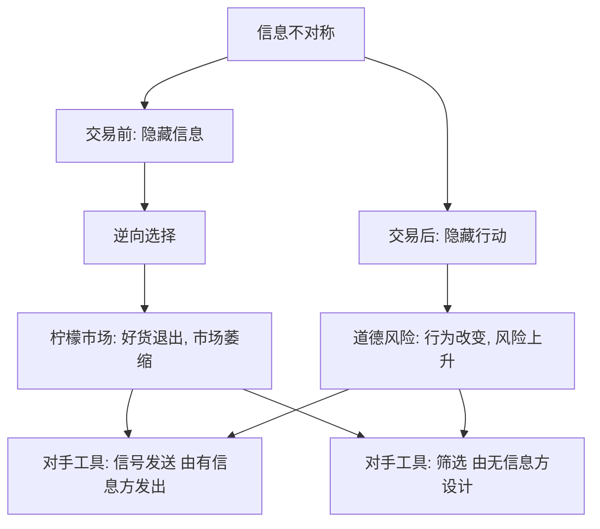

# 信息不对称：逆向选择与道德风险

> 当一方知道得更多，市场可能被「劣币驱逐良币」；信号与筛选是对抗它的制度发明。

**模块：** 01  **讲次：** 09  **类型：** Learn
**前置：** 01-03  **预计时间：** 45–60 分钟
**AI 生成提示词：** gen-prompt.md

## 学习目标

1. 能区分交易前的「逆向选择」与交易后的「道德风险」，并各举一个例子
2. 能复述柠檬市场模型，说清高质量卖方为何退出、市场为何可能萎缩甚至消失
3. 能区分「信号发送」与「筛选」，并指出各自的施动方是谁
4. 能判断一项制度安排（担保、品牌、认证、强制参保）是在缓解哪一类信息问题

## 问题背景

你有一台保养得很好的二手车要卖。你清楚它的真实车况——从没出过大事故，按时保养，里程不高。可站在对面的是一个陌生人，他分不清你这台车和隔壁那台三年修了五次的车。于是他只能按一个折中的判断出价：既然市场上的车好坏参半，我就按"平均质量"给钱。这个价格对你这种好车卖家来说明显偏低，你觉得亏，干脆不卖了。可他并不知道自己错过了什么，他只看到愿意在这个价位成交的车越来越少，于是把出价再压一压。

这一圈循环如果一直走下去，会得到一个反直觉的结局：**好车先退出，市场上剩下坏车的比例升高，买方把价格压得更低，于是又有一批次好的车退出……** 到最后，交易可能萎缩到几乎不存在。买卖双方谁都没有恶意，市场却自己"烂"掉了。

上一讲（01-03）说，价格是分散信息的载体，它引导资源流向评价最高的用途。但那套逻辑有一个前提被悄悄省略了：**买卖双方对交易标的的质量，大致有共同的认识。** 你付多少钱，心里清楚买到的是什么成色。一旦这个前提被破坏——一方清楚、另一方不清楚——价格传递的东西就变了：它不再只传递"这东西稀缺不稀缺"，还传递"卖方觉得这东西值不值得留"。

现实里，这样的落差到处都是。保险公司的投保人比保险公司更清楚自己的健康状况与驾驶习惯；求职者比雇主更清楚自己的能力；借款人比银行更清楚自己的还款意愿。信息分布不均本身不是骗局，它只是一种**结构性的不对称**。

Akerlof 在 1970 年把这个直觉写成了模型，用的正是二手车（英文俚语里称有缺陷的旧车为"柠檬"，故称"柠檬市场"）。他的结论相当尖锐：如果买方完全无法辨别质量、只能按平均质量出价，那么质量高于平均的卖方就会退出，市场可能萎缩甚至消失。这就构成张力的一半——**有些市场会因为信息问题而"自毁"**。

张力的一半在另一边。现实中的二手车、保险、信贷市场并没有全部垮掉。它们靠的是一整套制度发明：担保、品牌、第三方认证、评级、强制参保。换句话说，**信息不对称是一种市场失灵，而人类发明了工具去修理它**——这些工具怎么起作用、能修到什么程度，就是本讲要讲清的事。

## 核心概念

先抛开术语，用日常语言说。信息不对称的核心处境是：**交易的两个人，对同一件事知道的多少不一样。** 而"不一样"发生在交易的哪个时点，决定了它变成哪一种病。

**信息不对称**：交易的一方掌握另一方不知道的信息，使市场结果偏离效率。它最常见的两种形态是"隐藏信息"（一方知道自己的类型，另一方不知道，发生在**交易前**）与"隐藏行动"（一方在交易后的行为无法被对方观察，发生在**交易后**）。

**逆向选择**：发生在**交易前**。"逆向"指的是留下来的往往是最不受欢迎的那类人。因为卖方知道质量而买方不知道，买方只能按平均质量出价，于是**劣质方更愿意参与、优质方更不愿参与**，市场平均质量被拉低。二手车卖家、高风险投保人、健康状况差的借款人都属于"更愿意参与"的那一类。

**道德风险**：发生在**交易后**。因为一方不必承担自己行为的全部后果（比如买了保险），他就**改变了行为、增加了风险**。逆向选择问的是"谁会来参加"，道德风险问的是"参加之后会怎么做"。

**柠檬市场**：Akerlof 模型的名称，用来描述"买方只愿按平均质量出价 → 高质量卖方退出 → 平均质量下降 → 出价进一步压低"的自我强化过程，其终点可能是市场的萎缩甚至消失。

**信号发送**：**拥有信息的一方**主动传递一个可信的凭证，让对方相信自己的类型。文凭、品牌、长期保修、昂贵广告都是信号——它们的共同点是，只有"真的好"的一方才有能力或才划得来发出这种信号。

**筛选**：**信息劣势的一方**设计一套合同或机制，让对方在选择中**自己暴露类型**。保险公司提供"高免赔额、低保费"与"低免赔额、高保费"两种合同，让低风险的人自选前者、高风险的人自选后者，这就是筛选。

用一个例子把两组概念串起来：二手车市场里，**卖方花钱做第三方检测、把报告贴在车窗外**，是信号发送（有信息的一方证明自己）；**买方平台强制要求上架车辆都附检测报告、并区分"已检测/未检测"**，是筛选（无信息的一方设计门槛）；而如果买家发现"被认证的车反而更容易出毛病"，那又是另一层问题——信号本身可能被伪造或被过度信任。

## 经济学视角

经济学在本讲里提供的是一套"信息—制度"的分析框架，它把"信任"这种模糊的词拆成了可操作的机制。

**核心工具是均衡与激励。** 经济学不满足于说"信息不对称会导致市场失灵"，它要问：在既定的信息结构下，各方的**最优反应**会得到什么样的均衡？柠檬市场的崩溃不是假设，而是一条推理链的结果：给定买方只按均价出价，好车卖方的**激励**是不卖（因为卖就亏），而这条激励又反过来验证了买方的低价预期，于是形成了一个自我实现的悲观均衡。这说明**信息问题本质上是一个激励问题**——不是"人变坏了"，而是"给定信息结构，变坏是最优的"。

**由此引出制度的作用，也就是机制设计。** 如果信息问题源于激励，那么修复它的办法就是**改变激励，让说实话变得划算**。信号发送要求信号"贵到只有真的好的一方发得起"——文凭之所以有用，不是因为学了什么，而是因为能力差的人拿到它的成本更高。筛选要求合同设计得让不同类型的人**自愿**分开选择，而不是被迫统一。担保制度的妙处在于：它把"我保证车没问题"这句无法验证的话，变成"如果我说谎，我自己赔钱"这个可执行的承诺。

**经济学的落点是福利与效率。** 信息不对称被列为第 01-10 讲要展开的"市场失灵"之一，与外部性并列。它的特别之处在于：它不需要任何一方违法或恶意，纯粹由信息分布的结构造成；而修复它的制度（认证、评级、强制参保）本身也有成本，并且可能被扭曲。经济学因此给出的是一个**比较制度**的问题：没有完美的解法，只有在具体信息结构下哪个制度更划算。

## 心理学视角

心理学补上的是**人在信息缺失时如何形成判断**，以及这些判断如何让信息问题变得更黏。

**信任与线索依赖。** 当质量无法直接观测，人不会悬置判断，而会抓住**可得、易处理的线索**来替代：品牌、销量、评分、熟人推荐。这不是懒惰，而是有限理性下的必要简化——你不可能为每一笔交易做一次尽职调查。问题在于，这些线索与真实质量之间只是**相关**，不是因果，一旦被反过来利用（刷单、刷好评），线索就会与质量脱钩。

**归因与刻板印象。** 人对"某类车=坏车""某类借款人=高违约"会形成快速的整体印象。这种印象在信息稀缺时是一种有效的省力工具，但它会**过度泛化**：一台好车因为品类被贴上坏名声而遭贱价，正是逆向选择在认知层面的镜像——不是这台车不好，而是它被归进了"平均质量"里。

**信号的可信度依赖认知捷径。** 讲得贵、包装精美、请大牌代言，之所以能充当质量信号，是因为消费者用"花得起这个钱说明有实力"来做推断。但这条推断可以被反向利用：**造假者也能花钱**。心理学因此解释了为什么"看起来很像信号"的东西未必是有效信号——可信度不只取决于成本，还取决于受众会不会做那种推断。

**社会规范与声誉。** 在重复互动的社区里，"大家都认识彼此"本身就是一种信息修复机制，它靠的不是合同，而是**声誉约束与社会规范的执行**。这解释了一个现象：同样的交易，在熟人网络里信息问题小得多，一旦搬到陌生人的大市场，才需要制度化的认证与担保来补位。

心理学的短板也要说清楚：它擅长解释**个体为何依赖某个线索**，却不负责说明这个线索在均衡中会不会被套利、被制度替代。线索会不会被造假，最终要看市场的激励结构。

## 交叉洞察

这一节是本讲存在的理由，所以它不能写成"经济学看制度、心理学看信任"这类并列句式。真正的结构是**分工**加**张力**。

**分工。** 经济学提供**信息结构与激励的框架**，心理学提供**人在信息缺失下如何判断**。这也是一条流水线的上下游：心理学说"人会依赖品牌、评分、熟人这些省力线索来替代看不见的质量"，经济学接着问"那么在这些线索可以被人为制造的市场里，均衡会变成什么样——线索会被造假，还是会被制度替代"。只做前半句是消费者心理学，只做后半句是产业组织与机制设计，两半都做、并且互相校验，才是信息不对称的交叉研究。

**张力。** 核心的一句话是：**制度能修理信息问题，但用来修理的制度本身，也会被同一套心理机制盯上。** 具体有三条：

1. **修复工具与滥用工具同源。** 品牌、认证、评级之所以能当信号，是因为人相信"成本高=质量好"这条推断；而**只要有人相信这条推断，就一定有人来伪造它**。于是市场进入军备竞赛：认证之外还有认证，评级之外还有反刷分机制。这意味着信息不对称的修复是**动态的**，不是一劳永逸的。
2. **信号的有效性取决于受众会不会做那种推断。** 同一份"官方认证"，对懂行的人可能意味着质量，对不懂行的人可能意味着"可以放心不看别的了"——后者反而降低了警觉。信号的强度与它的实际信息量，并不总是同向。
3. **心理线索与制度修复可以互相冒充。** 一条"销量 10 万+"的展示，既是真实的从众线索（社会规范），也可能只是花钱投流的结果。当心理线索容易被制造，制度就必须提供一个**更贵、更难造假的**替代品来锚定信任。这解释了为什么越是信息问题严重的市场，越依赖第三方背书而不是自我宣传。

**所以本讲的位置是：** 01-03 让你看到价格如何传递信息，本讲指出这个机制在信息分布不均时会失灵；01-10 会继续补充市场失灵的另一大类——外部性。三者合起来，构成"市场有时靠不住"的三条线：风险（01-08）、信息（本讲）、外部性（01-10）。

## 现实案例

1. **二手车市场与车况认证（如 Carfax 车况报告）。** 二手车是柠檬市场的教科书场景：车况是"隐藏信息"，买方远不如卖方清楚。像 Carfax 这样的第三方车况报告服务，正是对逆向选择的制度化回应——它把"事故记录、里程、权属变更"等历史信息汇总成一份**可核查的报告**，让买方不必完全依赖卖方的口头承诺。这类服务的意义在方向上很清楚：它把不可观测的质量，部分地变成了可观测、可比较的记录，从而**缩小了买卖双方的信息落差**，让好车不至于被笼统地按"平均质量"贱卖。（认证并非万能：没有报告覆盖的车、以及刻意规避记录的车辆，仍会构成缺口；本课不给未经核实的具体比例。）

2. **保险市场的逆向选择与强制参保。** 保险是另一个经典场景：投保人比保险公司更清楚自己的风险。若保费按平均风险定价，**低风险的人会觉得不划算而退出，高风险的人更愿意留下**，结果是风险池里高危者比例升高，保险公司被迫提价，进一步挤走低风险者——这正是逆向选择，也是柠檬市场在保险上的翻版。制度上的对策之一是**强制参保**：让低风险者无法退出，风险池保持完整，保险才可能以可负担的价格持续供给。要注意区分：强制参保针对的是**交易前**的逆向选择；它并不直接解决**交易后**的道德风险（买了保险后可能开车更不小心），后者要靠免赔额、共同保险、激励条款来约束。

## 常见误区

1. **误区：信息不对称就是"有人骗人"。**
   错在哪：把一种**结构性的信息差异**当成了诚信问题。柠檬市场里买卖双方都没有撒谎，市场照样可能萎缩，因为卖方只是选择"不卖"，这正是他的最优反应。
   正确的说法：信息不对称描述的是"谁知道得更多"的分布本身，它是市场失灵的一种，不需要任何人违法或恶意；骗人是另一回事（欺诈），两者不能混为一谈。

2. **误区：逆向选择与道德风险是一回事。**
   错在哪：把发生在不同时点、针对不同对象的两件事合并了。
   正确的说法：逆向选择在**交易前**，问的是"谁会来参加"，源于"隐藏信息"；道德风险在**交易后**，问的是"参加后会怎么做"，源于"隐藏行动"。前者使风险池恶化，后者使已参保的人改变行为、增加风险。

3. **误区：柠檬市场模型证明了所有信息不对称的市场都会崩溃。**
   错在哪：把一个**基准模型的条件性结论**读成了普遍预言。Akerlof 的结论依赖"买方完全无法辨别质量"这一极端设定。
   正确的说法：现实中市场常通过担保、品牌、认证、评级、强制参保等制度缓解柠檬问题，因此"Akerlof 式崩溃"的普遍性受到质疑。模型的价值在于指出机制，而不是预言结局；它更像一个警示，说明信息结构一旦变化，市场可能走向哪里。

## 经典研究 5 分钟摘要

- **作者/年份**：Akerlof, G. A. (1970), *"The Market for 'Lemons': Quality Uncertainty and the Market Mechanism"*, *Quarterly Journal of Economics* 84(3)。
- **结论**：当买方无法辨别质量、只愿按**平均质量**出价时，质量高于平均的卖方会因为价格偏低而退出市场，留下来的是质量较低的一方；这又压低买方对平均质量的估计，使出价进一步下降，市场可能因此**萎缩甚至消失**。这个由信息不对称驱动的过程被称为逆向选择，是市场失灵的一种，且不需要任何一方欺诈。
- **争议**：模型的核心结论建立在"买方完全无法辨别质量"这一极端假设上。现实中，市场往往通过**担保、品牌、第三方认证、评级**等制度缓解柠檬问题，使坏车难以蒙混、好车得以证明自己，因此"Akerlof 式崩溃"在现实中的**普遍性受到质疑**——许多信息不对称的市场并没有垮掉。争论的焦点因此不是"信息不对称是否重要"，而是"给定现实中的各种制度，它究竟会走到多严重"。

## 自测题

1. 凭直觉判断：如果二手车买家无法分辨好车坏车，只愿按「平均质量」出价，长期最可能出现什么？
2. 「逆向选择」与「道德风险」的关键区别是什么？
3. 以下哪一项属于「筛选」（screening）而不是「信号发送」（signaling）？
4. 在 Akerlof 的柠檬市场模型中，市场可能萎缩甚至消失的直接机制是什么？
5. 政府推行强制参保（如强制车险）后，最可能缓解的问题是什么？
6. 某在线平台推出「卖家信用评级」与「无理由退货」，从信息不对称的角度看，其主要作用是什么？

## 延伸关键词

信息不对称、逆向选择、道德风险、柠檬市场、信号发送、筛选