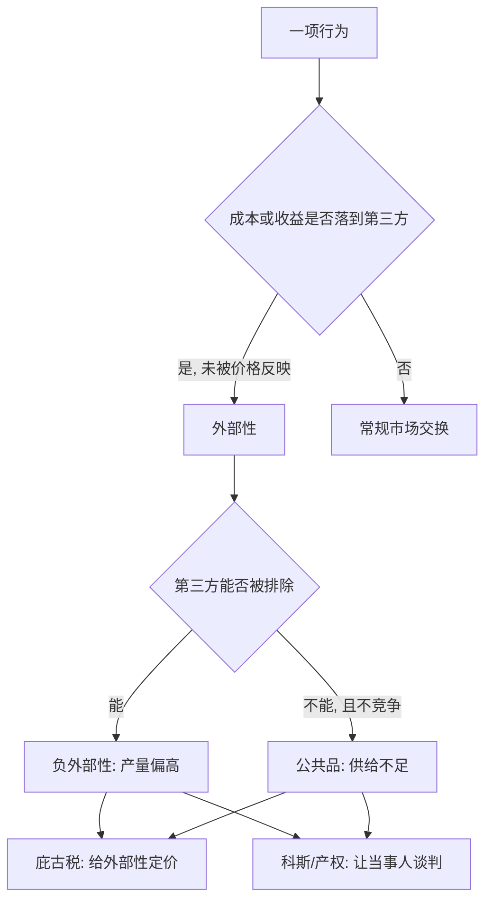

# 福利与外部性：市场失灵

> 当行为的成本落到无关第三方身上，市场价格就不再是全部真相，外部性与公共品是市场失灵的主场。

**模块：** 01  **讲次：** 10  **类型：** Learn
**前置：** 01-04  **预计时间：** 45–60 分钟
**AI 生成提示词：** gen-prompt.md

## 学习目标

1. 能识别一项行为是否产生外部性，并判断它是正外部性还是负外部性
2. 能用「非排他性」与「非竞争性」两个特征说明公共品为何会被供给不足
3. 能复述科斯定理及其成立条件，并说明「交易成本」为何是它的关键
4. 能区分「庇古税」与「产权交易（总量控制与交易）」两种治理外部性的思路

## 问题背景

河的上游有一家工厂，下游有一片渔场。工厂生产得很顺利，成本账算得清清楚楚：原料、人工、设备。但它排出的废水顺流而下，让下游的鱼大量死亡——这部分损失，从来没有出现在工厂的账本上。工厂做决策时看到的成本，只是它自己付出的那一部分；而被污染者承担的那一部分，被漏在了账本之外。

上一讲（01-04）我们讲了均衡与市场出清：价格会调整到供给恰好等于需求，资源流向评价最高的用途。但这套结论有一个被悄悄省略的前提：**每一笔交易的成本和收益，都被买卖双方自己承担和享有。** 工厂卖东西，买方付钱，卖方收钱，账算得干净。可一旦有第三方——渔场、下游居民、呼吸空气的路人——被牵扯进来，而他们的损失又没进价格，那么"价格等于真实成本"这条链子就断了。

外部性只是这类漏账的一种。还有一类更微妙的漏账：有些东西，你消费它不影响别人消费它，也几乎没办法拦着别人不消费它——比如路灯、干净空气、国防。这样的东西叫**公共品**。市场机制在这里遇到了结构性的困难：**没有人愿意为一个自己无法被排除在外的收益付费**，于是大家都等着别人出钱，东西就供给不足。

这些情形有一个共同的名字：**市场失灵**——市场自发运行达不到效率的状态。注意，市场失灵不等于"市场不好"。它只是说，在特定结构下，看不见的手会失灵，需要额外的东西（税收、产权、配额、制度）来矫正。而矫正的思路恰好分成两大派：

一派问**"该怎么定价"**：既然工厂把治污成本甩给了别人，那就按它造成的边际外部成本收一笔税，让外部成本重新回到它的账本里。这是**庇古税**的思路，核心是政府出手把价格修正到"真实"。

另一派问**"产权归谁"**：如果河水的清洁权、排污权界定清楚，让工厂和渔民自己去谈，他们难道谈不出一个双方都能接受的结果吗？这是**科斯**的思路，核心是不预设谁对谁错，而是把产权明确，让谈判去解决。这两种思路的张力，就是本讲后半段的重点。

## 核心概念

先抛开术语，用日常语言说。市场的价格本该反映"做这件事要付出多少代价"，但当代价落到**局外人**头上，或者收益溢出到**局外人**身上时，价格就只反映了故事的一半。

**外部性**：一项行为对**无关第三方**造成的成本或收益，且这部分没有被市场价格反映。
- **负外部性**：第三方承担了成本，却没有被补偿——工厂排污、车辆尾气、深夜噪音。
- **正外部性**：第三方得到了收益，却没有为此付费——你打疫苗降低了别人被传染的概率、邻居翻修花园美化了整条街。

**公共品**：同时具备**非排他性**（无法有效阻止别人享用）与**非竞争性**（多一个人享用几乎不减少别人能享用的量）的物品。路灯、国防、清洁的空气都是例子。正因为无法排除他人，每个人都会想"让别人出钱、我来搭便车"，于是**市场供给不足**（甚至完全不供给）。

**市场失灵**：市场自发配置无法达到效率的状态。本课遇到的三大来源是：外部性（本讲）、公共品（本讲）、信息不对称（01-09）。外部性与公共品在算术上是近亲——公共品可以看成"正外部性"最极端的形态：一个人提供，所有人受益，且无法排除。

**科斯定理**：若**产权明确**且**交易成本为零**，当事人可以通过谈判达成有效率的结果，**且该结果与产权的初始归属无关**。直觉是：不管法律把"能否排污"的权利判给谁，只要双方能自由谈判，工厂和渔民总会谈出一个总收益最大的安排——因为只要还有改善空间，就一定有双方都愿意接受的价码。

**交易成本**：为了达成与执行交易本身所耗费的成本——搜寻、谈判、签约、监督、执行。它是科斯定理在现实中失效的关键。现实中谈判方众多、损失难以计量、执行难以监督，交易成本往往不为零，因此"让双方自己谈"未必真的能谈成。

**庇古税**：对产生负外部性的行为，按其**边际外部成本**征税，使外部成本"内部化"到行为者的账本里。税额定得对，行为者就会自发把产量调整到社会最优水平。补贴则是它的镜像，用于鼓励正外部性。

**公地悲剧**：当一项资源**没有排他性的产权**，每个人都有一份使用权时，每个人过度使用的私人成本低于社会成本，结果资源被过度使用直至枯竭。牧场、渔场、地下水资源都是典型。

一个把概念串起来的例子：一个小区要不要装路灯。路灯是典型的公共品（谁都能借光、多一个人照明不减少别人），所以"大家自愿出钱"通常会失败——每个人都想搭便车。若换成一条收费的私人步道，情况就完全不同：能排除未付费者，就能收费，供给自然出现。**同一件"照明"，因为排他性有无，制度结果天差地别。**

## 经济学视角

经济学在本讲里的角色是**给外部性定价、给制度做比较**。它把一个看似道德问题（谁污染谁就该负责）转译成效率问题（怎样安排才能让总收益最大），再回头讨论由此带来的分配问题。

**核心工具是「社会成本」与「私人成本」的分离。** 私人成本是决策者自己承担的部分，社会成本还要加上外部成本。当私人成本低于社会成本，决策者的产量就**偏高**——这是负外部性的标准诊断。相应地，正外部性下私人收益低于社会收益，产量偏低。经济学的贡献在于把"多了多少、少了多少"变成一个可以用边际量刻画的问题：**只有当边际社会成本等于边际社会收益时，配置才有效率。**

**由此得到两类治理工具，思路截然不同。**
- **价格工具（庇古税/补贴）**：政府直接给外部性定一个价——按边际外部成本征税。优点是简单、可预期；难点在于政府未必知道边际外部成本到底是多少，税率定高定低都会造成新的效率损失。
- **数量/产权工具（科斯式谈判、总量控制与交易）**：政府设定排污的总量上限，然后把许可**分配成可交易的产权**，让市场自己在配额之内发现价格。谁减污便宜，谁就多减、把配额卖出去；谁减污昂贵，谁就买配额。这一路的精髓是：**政府只需要管住总量，具体价格交给交易去发现。**

**经济学的落点是分配问题。** 科斯定理说"结果与产权初始归属无关"，指的是**效率**（总产出）与归属无关，但**分配**当然有关：排污权判给工厂还是判给渔民，会让谁受益、谁受损完全不同。这与 00-01 讲的"描述性与规范性必须分开"一脉相承——一个制度有效率，不代表它的分配结果对每个人都好。经济学因此坚持把"效率"和"公平"当成两个可以分别讨论的问题。

## 心理学视角

心理学补上的是**人为什么会搭便车，以及为什么有时又不搭便车**——公共品与外部性治理的成败，很大程度上取决于这两件事。

**搭便车与自利。** 公共品的非排他性，意味着"不做贡献也能享受"。在纯粹自利的计算下，不贡献是占优的，于是公共品供给不足。这是公共品困境的基准解释，它解释了为什么自愿捐款总是难以覆盖公共支出。

**但人并不总是纯自利。** 大量实验与田野证据表明，公共品博弈中总有一部分人愿意贡献（哪怕可能被搭便车），而这种贡献对**社会规范**与**公平感**高度敏感。当人感到"别人也在出钱"，就更愿意出；当感到"只有我在当冤大头"，贡献会迅速崩塌。这引出一条重要的政策含义：**公共品的制度设计不只是算钱，还要管理"别人是否也在付出"的信念。**

**心理所有权与禀赋效应。** 一旦排污权、捕捞配额被当作"我的权利"分配下去，持有者就会对它产生**心理所有权**——回收或削减配额，会被体验为"失去本该属于我的东西"，而不是"少赚一笔钱"。这解释了为什么总量控制与交易在执行中常常遇到被分配方对配额回收的强烈抵制，也提示制度改革要照顾这种心理成本。

**公平感与互惠。** 外部性的治理常常触发关于"谁该掏钱"的公平判断。同一笔庇古税，如果被理解为"污染者付费"，接受度会高；如果被理解为"政府变相收费"，则可能遭到抵制。这属于科斯定理没纳入的东西：谈判能否达成，不只取决于有没有交易成本，还取决于各方是否觉得**分配是公道的**。

心理学的短板同样要说明：它擅长解释个体为何贡献或搭便车，却不负责说明在均衡中制度会走向何方。贡献意愿会不会被稀释、配额会不会被交易殆尽，最终仍要看市场结构与制度规则。

## 交叉洞察

这一节是本讲存在的理由，所以它不能写成"经济学管定价、心理学管人心"这类并列句式。真正的结构是**分工**加**张力**。

**分工。** 经济学提供**外部性的度量与制度工具**（社会成本—私人成本、庇古税、产权与配额、科斯定理），心理学提供**人在公共品与外部性情境中如何反应**（搭便车、社会规范、公平感、心理所有权）。这是一条流水线的上下游：心理学说"人不是纯自利的，贡献意愿对社会规范与公平感敏感"，经济学接着问"那么在这些情绪可以被制度设计利用或伤害的市场里，均衡会变成什么样"。只做前半句是行为公共品研究，只做后半句是机制设计，两半都做才是本讲的交叉立场。

**张力。** 核心的一句话是：**制度能把外部性内部化，但制度工具会被人心的反应改写其效果。** 具体有三条：

1. **价格工具会改变行为的"含义"。** 把外部性定价（庇古税、罚款）在激励上有效，但可能把原本由**道德或社会规范**约束的行为，重新框定为"付费购买的权利"——这正是 00-01 提到过的"罚款即价格"的机制。一旦污染被理解成"交钱就可以排"，道德约束可能被挤出，净效果未必如静态模型预测的那样干净。
2. **配额的分配会制造心理所有权。** 科斯式安排假定产权可以自由交易，但被分配出去的权利会变成"我的东西"，回收或再分配会遭遇禀赋效应带来的抵制。**产权越清晰，越稳，也越难改**——这既是它的优点，也是它的代价。
3. **公共品供给依赖"别人也在付出"的信念。** 由于贡献意愿对社会规范高度敏感，"信息公开、让贡献可见"本身就成了治理工具。反过来，如果制度让人怀疑"只有我在出钱"，公共品供给会迅速瓦解。**这与 01-09 的信息问题是同一件事的两面**：信息既能让市场失灵，也能被用来修复失灵。

**所以本讲的位置是：** 01-04 的均衡告诉你价格如何协调资源，本讲指出这个协调有三处结构性缺口——风险（01-08）、信息（01-09）、外部性（本讲）。填这些缺口，不能只靠"让市场自己来"，也不能只靠"政府来定价"，而要在**定价、产权、信息、心理**之间做具体权衡。这正是行为公共政策在模块 04 要展开的内容。

## 现实案例

1. **欧盟碳排放交易体系（EU ETS，2005 年起）。** 二氧化碳排放是典型的负外部性：排放者获得生产收益，气候的成本由全球第三方承担，且不进任何一家企业的账本。EU ETS 的思路属于**总量控制与交易**：政府给受管制部门设定排放总量的上限，把排放权按配额发放，并允许企业之间**交易配额**。减污成本低的企业会多减排、把富余配额卖出获利；减污成本高的企业则买配额。这样，**价格由政府设定的总量与市场交易共同发现**，而政府只需盯住总量这根闸门。它的制度化意义在于：把一项跨境的、无形的外部性，变成了可计量、可交易、有价格的产权。（体系经历了多阶段改革，覆盖范围与配额规则不断调整；本课不给出未经核实的具体减排比例。）

2. **渔业过度捕捞与个体可转让配额（ITQ）。** 海洋渔业是公地悲剧的经典现场：鱼群没有排他性产权，每个渔民多用一分资源的私人成本，大部分由全体渔民共同承担，于是大家竞相捕捞，鱼群被过度消耗。**个体可转让配额（ITQ）** 是对这一困境的制度回应：管理者把总可捕量按份额分割，分配给个体渔民，并允许这些配额在渔民之间交易。配额给了每个使用者一份**可执行、可转让的权利**，把"多捕鱼的成本"重新变回他自己账本里的机会成本（多捕就意味着要买别人的配额，或放弃卖配额的收入），从而给过度捕捞装上刹车。它同时体现了本讲的两条思路：**既界定了产权（科斯式），又通过总量控制给资源设了上限。**（配额制度在不同国家的具体设计与效果差异很大，也存在对小渔民公平性与生态侧效应的讨论；本课只描述其机制方向。）

## 常见误区

1. **误区：有外部性，就必须由政府出面管制或征税。**
   错在哪：把科斯式思路漏掉了，也忽略了正外部性的存在。产权明确、当事人少、交易成本低的情形下，谈判本身就可能解决问题。
   正确的说法：治理外部性至少有两条路——政府给外部性定价（庇古税），或明确产权让当事人谈判（科斯式），还可以是两者的组合（总量控制与交易）。选哪条路取决于交易成本、当事人数量与信息条件，不能默认"当然靠政府"。

2. **误区：公共品就是「人人都需要的必需品」。**
   错在哪：把"重要性"当成了定义。公共品的界定标准是**非排他性**与**非竞争性**这两个技术特征，与它对生活有多重要无关。
   正确的说法：粮食、住房对生活极为重要，但它们有排他性、可收费，因此不是公共品，市场可以供给。相反，一件不太重要但无法排除他人的东西（比如一座谁都能看的地标灯光）反而更接近公共品。定义看特征，不看价值。

3. **误区：科斯定理说只要把产权界定清楚，外部性问题就能自动解决。**
   错在哪：漏掉了定理的关键前提——**交易成本为零**。现实中当事人可能成千上万（空气污染）、损失难以计量、执行难以监督，交易成本并不为零。
   正确的说法：科斯定理是**基准**而非处方：它告诉我们"零交易成本下产权安排就够用"，正因为现实中交易成本往往不为零，税收、制度与组织才变得重要。此外，即便谈判达成了有效率的结果，**分配后果仍取决于产权归属**——效率与公平必须分开看。

## 经典研究 5 分钟摘要

- **作者/年份**：Coase, R. H. (1960), *"The Problem of Social Cost"*, *The Journal of Law and Economics* 3。
- **结论**：Coase 重新审视了"谁损害谁"的经典问题（如工厂排污损害渔民），主张外部性**本质上是双方在争用稀缺资源**，而非单方面的加害。若**产权明确**且**交易成本为零**，当事人可以通过自愿谈判达成最有效率的安排，**且该结果与产权的初始归属无关**——这就是后人所称的"科斯定理"。它的政策含义是反向的：真正需要关注的往往不是"谁对谁错"，而是**降低交易成本、明确产权**，让谈判能够发生。
- **争议**：至少三点受到持续讨论。其一，**"零交易成本"假设的现实性**——现实中当事人众多、信息与执行成本高昂，谈判常常无法达成，定理的适用性因此受限。其二，**对分配的影响**——即便结论"有效率"，产权判给谁仍决定了谁受益、谁受损，效率与公平不能混为一谈。其三，**定理的解读本身**——"结果与初始归属无关"在字面上常被过度推广，许多学者强调它是对**效率**的陈述，而非对现实结局的预测。因此，科斯定理更应被当作分析制度的**基准视角**，而不是一条自动生效的规则。

## 自测题

1. 凭直觉判断：一家工厂排污损害了下游渔民，但排污成本没进入工厂的账本。市场自发运行的结果最可能是什么？
2. 下列哪一组特征最能定义「公共品」？
3. 科斯定理（Coase, 1960）的核心主张是什么？
4. 庇古税的作用机理是什么？
5. 欧盟碳排放交易体系（EU ETS）属于哪一类处理外部性的方式？
6. 渔业过度捕捞（公地悲剧）与个体可转让配额（ITQ）之间的关系是什么？

## 延伸关键词

外部性、公共品、市场失灵、科斯定理、交易成本、庇古税、公地悲剧