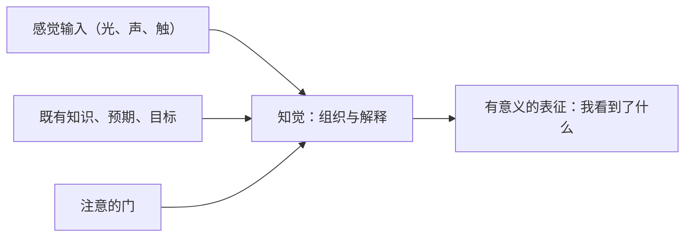

# 知觉与注意：信息如何进入心智

> 人并非被动接收世界的全部信息，知觉与注意先做了筛选，所以「看到什么」本身就是一个有待解释的问题。

**模块：** 02  **讲次：** 01  **类型：** Learn
**前置：** 00-01、00-02  **预计时间：** 45–60 分钟
**AI 生成提示词：** gen-prompt.md

## 学习目标

1. 能用自己的话说明知觉是对感觉信息的组织与解释，而不是对世界的被动复制
2. 能区分自下而上加工与自上而下加工，并指出预期在其中的位置
3. 能解释选择性注意、非注意盲视与变化盲视是同一套筛选机制的不同表现
4. 能说出为什么注意力是稀缺资源，以及界面争夺注意为什么接近零和

## 问题背景

设想这样一个场景：你每天走同一条路去上班，某天同事随口问「路口那家新开的咖啡店怎么样」，你却完全想不起来有过这家店。你确实从它门前走过，眼睛也朝着那个方向——可你对它毫无印象。这不是视力问题，而是你从没**注意到**它。

再换一个场景。一段监控视频里，一个穿着显眼的人在画面中走过，事后观看视频的人却一口咬定「画面里没有这个人」。他们不是撒谎，而是在观看时把全部注意都投向了别处。同一段录像，注意落在哪里，看到的内容就完全不同。

这两个场景指向同一件事：**「看到」并不等于「接收到」。** 眼睛把光信号送到大脑，这只是起点；真正决定你「看到什么」的，是接下来那一步筛选与解释。而这一步，平时你完全察觉不到。

本讲的张力就在这里：**世界每秒向感官倾泻的信息远超心智的处理能力，所以知觉与注意必须先做筛选；筛选本身是必要的，代价却是系统性的遗漏。** 经济学关心注意力这项稀缺资源如何被配置，心理学关心筛选是怎么在意识之外自动发生的。两边的答案合起来，才能回答「信息究竟如何进入心智」。

## 核心概念

先给一个直觉。你可以把感官想象成没有编辑的直播信号——画质再高，也只是一个持续滚动的原始流。要让它变成「我看到的房间」「我听到的对话」，心智必须做两件事：**选出值得处理的部分**（注意），再**把它们组织成有意义的整体**（知觉）。少了任何一步，你就只有一堆噪点。

用下面的流程感受这两步的关系：

三个关键术语：

- **知觉**：对感觉信息进行组织与解释、从而形成对外界有意义表征的过程。它是主动的建构，不是对外界的忠实翻拍。同一张照片，你按「花瓶」看和按「两张人脸」看，感觉输入完全一样，知觉结果却不同——差别来自你自己。
- **自下而上加工**：由外界刺激的物理特征驱动的知觉过程。光影、边缘、运动、频率这些客观属性，先把信息从下往上送。
- **自上而下加工**：由既有知识、预期与目标驱动的知觉与解释过程。你带着「这是一只鸭子」的提示去看一张模糊的图，就更容易真的看出鸭子。

- **选择性注意**：认知资源有限，人只能对部分信息做深度加工，其余被过滤。聚会上你能专注与一个人交谈，说明注意在「选边」；而你可能突然听见有人叫你的名字，说明被过滤掉的信息并非完全没被处理，只是多数时候达不到被你察觉的阈值。
- **非注意盲视**：注意力集中于一处时，对意料之外的显著刺激视而不见。它不是一个光学故障，而是「注意的门」关得太紧的必然后果。
- **变化盲视**：在缺乏注意时，人常常察觉不到视野中明显的变化。它和非注意盲视是同一种机制的两张面孔：前者漏掉的是「新出现的东西」，后者漏掉的是「已经变了的旧东西」。

一个日常例子能把三者串起来：你盯着手机屏幕回消息，路口的红灯变绿你却没动——这是变化盲视；旁边有人按喇叭提醒你，你也没立刻反应过来——这是非注意盲视；等回过神，你甚至说不准刚才路况有哪些车经过——这是选择性注意留下的空白。**注意在哪里，世界就在哪里成形；注意之外，世界几乎不存在。**

## 经济学视角

经济学在这里点名两个工具：**稀缺**与**注意力作为稀缺资源**，再点出**信息呈现方式就是选择的入口**。

**注意力是稀缺资源，而且是比钱更硬的那种。** 在 01-01 里我们已经确立：稀缺是「想要的超过可得的」，是一切取舍的根源。注意力完全符合这个定义——你想要的（每一条消息、每一个推荐、每一处广告）远远超过你能真正处理的，于是必须分配。和金钱不同的是，注意力无法储蓄、无法借贷、也无法由别人代你扩充；它每天的总量近乎固定。

**既然稀缺，就存在配置问题。** 谁来分配你的注意力？表面上是「你自己」，但经济学提醒你注意一个更实际的事实：你面对的信息并不是中性的。它们被精心排序、配色、配文、配动效，目的就是让自己在竞争中胜出。广告、货架摆放、界面按钮位置，本质上都是在争夺你那有限的注意力配额。**呈现方式的差别，直接决定哪些选项进入了你的选择集，哪些从未被考虑过。**

这就是经济学视角的关键落点：**选择开始于「被看到」，而「被看到」不是自然发生的，是被设计出来的。** 一个从未进入注意的选项，等价于不存在——它在你的选择里贡献为零，无论它本身多划算。

## 心理学视角

经济学告诉你注意力稀缺，心理学要回答的是：**这套筛选是怎么运行的，为什么关不掉？**

**注意是一道有硬容量的过滤门。** 认知资源有限，人只能对部分输入做深度加工。经典的双耳分听情境（左右耳分别播放不同内容、要求复述其中一路）说明：被忽略的那一路并非完全没进入大脑——它仍被粗略加工，所以你的名字、危险信号这类高优先刺激仍可能「破门而入」。但绝大多数时候，未注意的信息只被加工到很浅的层次，随时准备被丢弃。

**自上而下的预期塑造了「看到什么」。** 知觉不只从刺激往上走，也从知识往下压。你带着什么预期去看，就更容易看到与之相符的东西。预期是高效的——它让你不必每秒从零重建世界；但它也是偏的——当预期与事实不符，你可能看见并不存在的东西，或对明显的异常视若无睹。

**变化盲视与非注意盲视是这套机制的副产品。** 既然只有被注意的部分得到深度加工，那么「注意之外的显著刺激」和「注意之外的明显变化」就必然被漏掉。它们是同一枚硬币的两面，而不是两种独立的心理缺陷。**换个说法：不是人容易漏看，而是「不漏看」需要额外的注意成本，而人默认不愿支付它。**

## 交叉洞察

本讲的交叉点不能写成「经济学讲稀缺、心理学讲过滤」式的两段并列。真正的结构是**分工**加**张力**。

**分工。** 经济学提供**资源配置的框架**：注意力是稀缺资源，于是存在配置，于是有竞争、有争夺、有零和。它把这个现象放进「稀缺—取舍」的语言里，让你能问「这份注意力被分到了哪里、代价是什么」。心理学提供**机制与约束**：筛选是自动的、在意识之外发生的、且无法整体关闭，因此注意力总量不可被创造。**没有经济学，你会以为注意力只是个人意志问题；没有心理学，你会以为只要信息足够多、足够好，人就会自动看到它。**

**张力。** 张力至少有两处。

第一，**界面可以争夺注意，但注意力总量无法被创造。** 一个人每天能被深度加工的信息就那么多，你多占一分，别人就少一分。这就是为什么「把信息做得更显眼」的竞争，整体上更接近**零和**——所有参与者都在更用力地争抢一个总量固定的池子。**争夺改变了注意的分配，却没有改变它的容量。** 一个产品把界面做得更抢眼，未必让你「看到更多」，更可能是让你「看到别的东西更少」。

第二，**看得见与被看见，不能都当成人的选择。** 因为注意力可被设计者支配，很容易得出「用户自己没看到，是用户的错」这种结论。但从机制看，筛选是人省力的默认，不是懒惰。更可行的方向往往是**改呈现方式**：把关键信息放在注意会自然落到的地方，而不是指望人人时时保持高度警觉。**该被追问的是界面如何分配了注意，而不是被分配者够不够专心。**

**一句话收束：经济学告诉你注意力稀缺因而可被争夺，心理学告诉你筛选自动因而总量固定；两句话合起来，就是把「看到什么」从个人责任问题变成设计问题。**

## 现实案例

1. **驾驶中「看了却没看见」（looked-but-failed-to-see）。** 交通事故分析中有一类反复出现的情形：驾驶员事后坚称自己「看了」某个方向，也确实把眼睛转向了那里，却没有对出现的车辆或行人做出反应。研究者把这类现象归入一个方向性的解释：**眼睛对准了目标，注意却落在别处**，于是目标从未进入被深度加工的信息。它呼应了本讲的核心——「看」与「看见」是两件事。需要说明的是，这一研究方向主要来自事故报告的分析与归纳，本课只引用它提出的机制方向，不引用任何具体的事故比例或数字。

2. **电商或 App 界面如何争夺注意力（日常场景，非引用研究）。** 打开一个购物或内容类应用，你会看到一整套为争夺注意而设计的元素：首屏最大最鲜艳的横幅、自动播放的视频、红色的促销角标、「仅剩 2 件」的紧迫提示、以及不断续接的无限滚动。它们并不改变商品本身，只改变**注意被引导到哪**。在这个意义上，界面就是注意力的分配器：它决定了哪些选项有机会进入你的选择集，哪些从未被你看见。**注意：此条为对日常场景的描述，不是对某项研究的引用。**

## 常见误区

1. **误区：看见就是接收到，没看到是我视力或态度的问题。**
   错在哪：把「看」当成了被动接收。事实上眼睛送来的只是原始信号，是否形成「看见」取决于注意与知觉有没有把它组织进有意义的表征。
   正确的说法：「看到」是一个需要筛选与解释的过程。注意力未落在其上时，显著的刺激和明显的变化都可能不被察觉，这与视力好坏、态度端正与否无关。

2. **误区：知觉是对世界忠实的复制，各人看到的是同一个世界。**
   错在哪：忽略了自上而下加工。既有知识与预期会参与组织与解释，同一份感觉输入可以产生不同的知觉结果。
   正确的说法：知觉是主动的建构，带着预期和知识一起完成。它高效，也因此可能看见相符的东西、漏掉不符的东西——「客观」需要额外的检验，不是默认状态。

3. **误区：注意力只是意志问题，只要足够专心就能注意到一切。**
   错在哪：低估了注意容量的硬约束。筛选是自动的、无法整体关闭的，专心只是把门开在某一处，并不能让门消失。
   正确的说法：注意力总量有限且不可创造，专心只能改变注意分配到哪，不能让人同时深度加工全部信息。更可靠的做法是让关键信息落在注意会自然到达的位置。

## 经典研究 5 分钟摘要

- **作者/年份**：Simons, D. J. & Chabris, C. F. (1999)，《Gorillas in our midst: sustained inattentional blindness for dynamic events》，*Perception* 28(9), 1059–1074。
- **结论**：研究者让被试观看一段多人传球的视频，并要求他们专心数某一队的传球次数。在这样的注意负荷下，**相当一部分被试没有注意到**中途穿过画面、停留数秒的「大猩猩」（由人穿着猩猩服扮演）。研究者据此提出**非注意盲视**：当注意被持续占用时，意料之外的显著刺激可以完全不被察觉，而这种盲视在动态场景中同样稳定出现。
- **争议**：结果**强烈依赖条件**——注意负荷越高、意外刺激与被关注对象越相似，被漏掉的概率越大；不同版本实验中被漏掉的比例并不一致，本文亦未给出一个可外推的固定值。个体差异（谁更容易漏看）以及实验室结论向真实驾驶、监控等场景的推广性，至今仍有讨论。因此本课只写「相当一部分」这一方向性结论，并明确标注它依附于具体条件。

## 自测题

1. 你在熟悉的路上开车经过一家新开的店，事后却完全不记得见过它。这件事最可能的成因是什么？
2. 同一张模糊的图，有人先告诉你「这是一只鸭子」，你就更容易看出鸭子。这最能说明知觉的什么特征？
3. 在嘈杂的聚会上你能专注与一个人交谈，却可能突然听见有人叫你的名字。这最能说明选择性注意的什么特性？
4. 在短暂交谈中，一扇门挡过视线后交谈对象换成了另一个人，相当一部分被试却没发现。这属于哪种现象？
5. 一个视频网站在一集结束后自动播放下一集，并配以无限滚动。从注意的角度看，这种设计最可能在做什么？
6. 结合「注意力稀缺」与「筛选自动且不可关闭」，下面哪种说法最准确地描述了界面争夺注意的实质？

## 延伸关键词

知觉、选择性注意、自下而上加工、自上而下加工、非注意盲视、变化盲视、注意力有限
