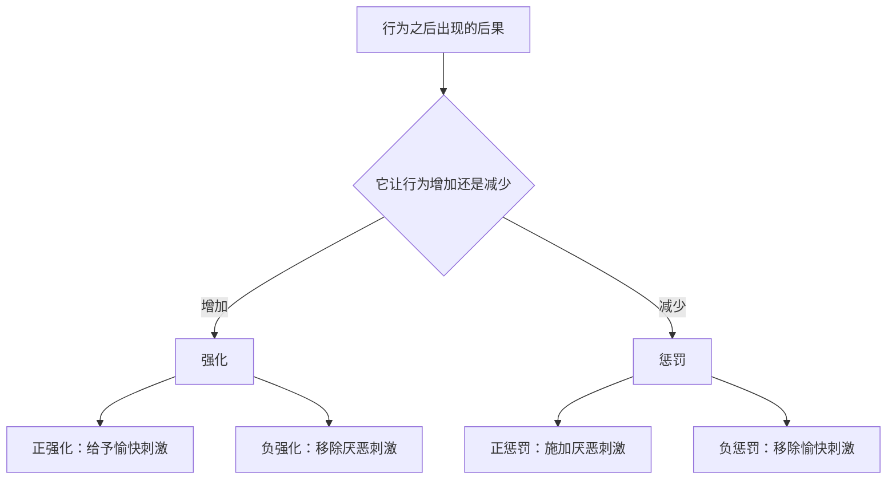

# 学习与强化：行为如何被塑造

> 行为不是由意志一次性决定的，而是被后果持续塑造；理解强化的规则，就能理解习惯、拖延与沉迷。

**模块：** 02  **讲次：** 03  **类型：** Learn
**前置：** 02-01  **预计时间：** 45–60 分钟
**AI 生成提示词：** gen-prompt.md

## 学习目标

1. 能用自己的话区分经典条件反射与操作性条件反射
2. 能用"正/负 × 强化/惩罚"四格判断一个后果会如何改变行为频率
3. 能说明强化程序（固定/变化 × 比率/间隔）如何影响行为的速度与持久性
4. 能解释消退与习得性无助的机制，并指出外部激励塑造行为的双刃性

## 问题背景

晚上十一点，你对自己说"就刷五分钟手机"，结果一抬头已经一个小时过去。你可能把这归咎于"意志力不够"。但再想一步：真正让你一次次滑下去的不是意志，而是每次滑动都可能冒出一条新内容——这个"可能"，正是后果在塑造行为。

行为分析给出的核心命题其实很简单：**行为不是被意志一次性决定的，而是被后果持续塑造的。** 一个行为之后跟着什么，决定了它以后更常发生还是更少发生。这不是"奖励使人听话"的老话，而是一套有结构、可预测的规则。

麻烦在于，后果在时间上并不整齐。有的即时兑现，有的拖很久；有的每次都来，有的时有时无。同一套机制，既可以把你训练成每天坚持练习的人，也可以把你训练成停不下手的人——好习惯与沉迷，用的是同一台机器。

本讲要做三件事：先把"后果塑造行为"这套规则讲清楚；再看经济学为什么把它叫做激励、以及激励在时间上的结构为什么关键；最后落到那个绕不开的张力——**同样的激励，既塑造好习惯，也制造沉迷。**

## 核心概念

先给一个直觉。你训练一只狗"坐下"：它每次坐下你就给零食，很快它一听到口令就坐。行为被它的后果改变了。反过来，如果有一天你不再给零食，它会先坐着等一等，然后慢慢就不常坐了。这套直觉就是操作性条件反射。而更早被发现的另一类学习，则是这样：先把一段铃声和食物反复配对，之后狗只听到铃声就开始分泌唾液——这里学会的是"刺激"之间的联结。

- **经典条件反射**：把一个中性刺激与能引发反应的刺激反复配对，使这个中性刺激也能引发该反应。学到的是"刺激—反应"的联结。
- **操作性条件反射**：行为因其后果（强化或惩罚）而改变发生频率。学到的是"行为—后果"的关系。
- **强化**：使某一行为更可能再次发生的后果。
- **惩罚**：使某一行为更不可能再次发生的后果。

"强化 / 惩罚"和"正 / 负"是两条独立的轴，必须分开看：

最容易踩的坑是：**负强化不是惩罚。** 负强化是"减去一个坏东西、让好行为更多"；惩罚是"让某个行为更少"，两者方向相反。

接下来是决定行为"节奏"的规则——**强化程序**。它说的不是给不给强化，而是**按什么规则给**：

- **固定比率（FR）**：做满固定次数给一次。速率高而稳定，但每次兑现后常出现短暂停顿。
- **变化比率（VR）**：平均若干次给一次，但哪一次不可预测。速率高、极难消退——老虎机、抽卡、信息流都属于这一类。
- **固定间隔（FI）**：隔固定时间给一次。临近兑现时才明显行动。
- **变化间隔（VI）**：隔不确定的时间给一次。行为平稳、缓慢而持久。
- **消退**：不再给予强化后，原本习得的行为逐渐减弱。它不是瞬时关闭，中途常伴随短暂的回弹。
- **习得性无助**：反复经历不可控的负性事件后放弃尝试，即使环境已经变得可控。

一句话统起来：**强化程序决定的不只是"行为会不会发生"，还有它多快、多稳、多难停下。**

## 经济学视角

经济学的语言里，后果就是**激励**：它改变行为的频率，而不必诉诸"意志"。一笔奖金、一条罚款、一次点赞，本质上都是对某些行为的强化或惩罚。

更精确地说，**激励相容**要求制度在设计之初就考虑人的实际反应：让个体在追求自身利益时，恰好也做成了集体想要的事。但要让它成立，必须处理激励的时间结构——即时还是延迟、固定还是变化。强化程序讲的正是这件事：同样大小的激励，按不同程序给，会养出节奏完全不同的行为。

**可变比率强化是其中最值得警惕的一种。** 当"做了多少才给、这一次到底给不给"都不可预测时，行为会被维持在高位而且极难消退。老虎机、社交媒体的下拉刷新与推送、游戏的随机抽卡，用的是同一个结构：不确定的下一发，让人无法收手。经济学应当把它理解成一种激励设计，而不是"人的弱点"。

## 心理学视角

心理学这边提供的是机制：**条件反射**说明后果怎样被学到；**强化程序**说明不同的给予规则怎样影响行为的速度与持久性；**消退**说明停止强化后行为如何衰减；**习得性无助**说明当后果与行为彻底脱钩时会发生什么。

其中两点容易被误解。其一，消退不等于行为的即时消失——去掉强化后，行为常常先短暂反弹，再慢慢减弱，所以"断了就没了"是错的期待。其二，习得性无助不是"人本来就消极"，而是**反复经历"做什么都没用"之后学到的一种结论**：我的行为不再影响结果。它和前面那条"行为被后果塑造"完全相容——只是这一次塑造出来的，是放弃。

## 交叉洞察

这一讲的价值不在"经济学讲激励、心理学讲条件反射"这样的并列，而在**分工**与**张力**。

分工是：**经济学用激励来预测行为的频率**，它不问你有多想，只问你之后会得到什么；**心理学给出激励起效的时间结构**——即时还是延迟、固定还是变化、可预测还是不可预测。少了经济学，你会以为行为只是偏好问题，看不见后果这根杠杆；少了心理学，你会以为"给激励"是同一件事，看不见同样的激励按不同程序给，会养出完全不同、甚至相反的行为。

张力是：**同一套机制既能塑造好习惯，也能制造沉迷。** 可变比率强化可以把一个人训练成每天坚持的练习者，也可以把他锁在老虎机前。因此"用好激励"不是一句正确口号，而是一个必须被认领的两难：设计者得回答，这个激励会长出哪一类行为。把激励当成单向的好工具，等于拒绝面对它的双刃性。

一句话收束：**经济学告诉你激励会改变行为，心理学告诉你它按什么节奏改变；而设计者的责任，是在两者之间为"长出好行为还是坏行为"负责。**

## 现实案例

1. **可变比率强化与博彩、社交媒体的即时反馈（应用向）。** 老虎机的核心正是变化比率程序：拉杆的次数是可控的，但中奖与否不可预测，于是行为被维持在高位且难以停止。社交媒体的下拉刷新用的是同一结构——每次滑动都可能出现一条值得看的内容，也可能什么都没有，这种不确定的即时反馈让"再看一条"变得极难收手。此处说的不是某个具体产品的数字，而是**一类共通的强化结构**：把奖励的给出变得不可预测，行为就会变得又快又稳又难消退。

2. **学校里表扬与惩罚的副作用（日常场景，非引用研究）。** 用公开表扬激励作业完成，短期确实有效；但如果表扬变成稀缺的、只有少数人拿得到的资源，它可能把"为了学会"悄悄改成"为了被夸"。而当外部奖励或惩罚挤压掉原本的兴趣，行为一旦失去奖励就会迅速衰减（即挤出效应的方向）。这不是说表扬与惩罚不能用，而是说**它们是激励设计，不是中性的口头动作**——给出方式决定养出哪一种动机。

## 常见误区

1. **误区：负强化就是惩罚。**
   错在哪：把"强化/惩罚"和"正/负"两个维度混成了一条轴，于是凡是带"负"字的都当成惩罚。
   正确的说法：强化与惩罚按"行为增加还是减少"分；正与负按"给予还是移除刺激"分。负强化是移除厌恶刺激、让行为更多；惩罚是让行为更少，方向相反。

2. **误区：只要给出奖励，期望的行为一定会增强。**
   错在哪：忽略了外部激励可能挤压内在动机（挤出效应）。奖励有时会削弱原本的兴趣。
   正确的说法：奖励是激励，但其形式与时机决定效果——不确定、不恰当的奖励可能把出于兴趣的行为改造成"为奖励而做"，奖励一停，行为就散。

3. **误区：习得性无助说明这个人天生消极、缺乏上进心。**
   错在哪：把经历塑造的结果误读成稳固的人格特质，于是看不到可改的环境。
   正确的说法：无助来自反复的"行为与结果无关"的经历；重建可预期的"行为—结果"联结，才是改动的方向。

## 经典研究 5 分钟摘要

- **作者/年份**：Seligman, M. E. P. & Maier, S. F. (1967)，《Failure to escape traumatic shock》，*Journal of Experimental Psychology* 74(1), 1–9。
- **结论**：先前经历过不可逃避电击的狗，之后被放进可以逃避电击的情境时，大多不尝试逃脱——它们似乎"学会"了自己的行为与后果无关，于是放弃了行动。
- **争议**：该实验引发明确的动物实验伦理争议；Seligman 早期把它解释为动机、学习与情绪上的缺陷，而 Maier & Seligman (2016) 后来重新解释为"无助更接近默认状态，动物真正学到的是可控性（行为与结果的关联）"，与早期解释并不相同；此外，该效应依赖前期确实存在不可控的经历，并非任何负性经历都会导致无助。

## 自测题

1. 你本打算"只刷五分钟手机"，结果一小时过去了。用"行为被后果塑造"的说法，这个"停不下来"该怎么解释？
2. 经典条件反射与操作性条件反射最关键的区别是什么？
3. 一个学生每次被点名都答不出，后来他学会了不举手，老师也不再点他，从此他更少举手。维持这个"更少举手"的，是正强化、负强化还是惩罚？
4. 固定比率与变化比率两种强化程序，对行为的"速度"和"不容易停下"有什么不同的影响？
5. 一个健身 App 在每次打卡后随机掉落积分（有时多、有时少、有时没有）。用强化程序的术语，它用的是哪种程序？为什么它比"每次都给固定积分"更能维持打卡？
6. 一位新员工连续几次提建议都没被采纳，以后再也不提想法。用习得性无助解释发生了什么，并说出管理者可以怎么改变这个局面。

## 延伸关键词

经典条件反射、操作性条件反射、强化、惩罚、强化程序、消退、习得性无助
