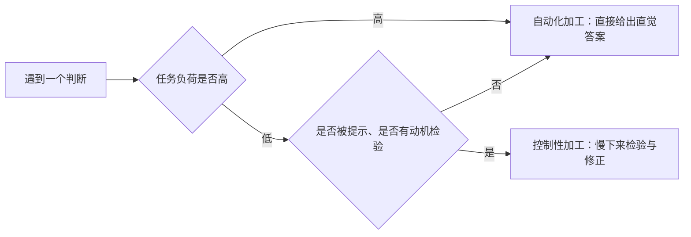

# 双系统加工：快思维与慢思维

> 心智有两套加工方式——快的自动系统与慢的控制系统——多数判断由前者完成，它只在特定条件下才被后者接管。

**模块：** 02  **讲次：** 04  **类型：** Learn
**前置：** 02-02、02-03  **预计时间：** 45–60 分钟
**AI 生成提示词：** gen-prompt.md

## 学习目标

1. 能用"自动化 / 控制性"两个维度判断一次判断走的是哪一套加工
2. 能说明认知负荷如何把加工从控制性推向自动化
3. 能解释"认知吝啬鬼"为什么不是懒惰，而是资源约束下的策略
4. 能把"有限理性"与默认选项的设计联系起来，指出制度常比说服更可靠的条件

## 问题背景

先别急着算，看这道题：**球拍和球一共 1.10 元，球拍比球贵 1.00 元，球值多少钱？** 你多半会先在脑子里浮出一个数。注意那个数是怎么出现的——它几乎不需要努力，像是自己冒出来的。而这道题的正确答案是 0.05 元，浮出来的答案却往往是 0.10 元。

为什么直觉先到？两个答案的差别不在算术难度，而在于后者要求你"慢下来"，重新设一遍方程：球 +（球 + 1.00）= 1.10。慢下来的那一步并不是更聪明，而是换了一套加工方式。

我们习惯把"思考"想象成一件费力的、带意识的事。但日常绝大多数判断——认出熟人的脸、扫一眼读懂一句话、判断一句评价是否真诚——都在另一种几乎不费力的方式下完成。真正的问题从来不是"人会不会思考"，而是**什么时候会切换到那套费力的加工。**

本讲要做三件事：介绍双系统加工这个描述框架；说明切换的条件（认知负荷、动机、提示）；最后落到交叉点——**为什么改环境（默认值、简化）常比"把道理讲清楚"更可靠。**

## 核心概念

先给一个直觉：你读上面那段文字时并没有逐字拼读，你认出熟人的脸也只用了一眼。大多数加工是自动的、省力的。

- **双系统加工**：把心智加工区分为"快速自动"与"缓慢控制"两类过程的描述性框架。它常被叫作系统一与系统二——要记住这是一个便于描述的框架，并不是脑子里真有两个盒子。
- **自动化加工**：无需努力、难以抑制、几乎不占注意资源。认脸、读熟悉的词、听到巨响就回头，都属于这一类。
- **控制性加工**：需要努力与注意、可被有意调节。心算 17×24、在陌生城市里按地图找路，都属于这一类。
- **认知负荷**：当前任务占用的工作记忆资源；负荷过高会迫使加工退回捷径。
- **认知吝啬鬼**：人倾向于用最少的认知努力达成"足够好"的判断。
- **认知反射**：抑制直觉答案、转而检验与推理的倾向，存在稳定的个体差异。

两套系统之间不是对立，而是**分工**，并且切换有明确的条件：

自动化让你在不费力的情况下快速应对世界，控制性在你需要时接管检验。没有自动化，每件事都得慢想，人早就瘫痪了；但只有自动化，错误也会被顺利地保留下来。

## 经济学视角

经济学在这里点是**有限理性**与**选择架构**这两件工具。

**有限理性**说的是：由于信息与计算能力有限，人追求"足够好"而非最优。古典的最优化模型要求决策者在无限算力下比较全部选项；现实中算不动，于是"满意即可"替代了"最优"。这恰好解释了球拍与球里那个脱口而出的答案——它是最省力的那个，而不是最正确的那个。

一旦承认有限理性，**默认选项与选择架构**就成了可用的杠杆。正因为多数选择走自动化那条路，环境的结构（默认值、选项排序、表单难度）能在不改变任何选项、不改变任何价格的情况下改变行为结果。退休储蓄的默认加入、订阅制的默认续费，都是选择架构。经济学的可操作结论是：当系统二不在场时，**改变"默认"往往比改变"说服"更能改变行为。**

## 心理学视角

心理学这边给出的是机制：**自动化加工 / 控制性加工**描述两套模式在努力程度与可抑制性上的差别；**认知负荷**决定切换——控制性加工依赖工作记忆，负荷一高就退回自动化；**认知反射**则刻画个体差异——同一道题，有人直接交直觉，有人会停下来检验，而且这种倾向相对稳定，并与多种判断偏好相关。

这三条连起来，就是一个可预测的过程：负荷低、有动机、受到提示时，控制系统容易被启用；反之，加工会默认交给自动化。**"思考"不是随时待命的，它需要被叫醒。**

## 交叉洞察

本讲的价值不在"经济学讲理性、心理学讲直觉"这样的并列，而在**分工**与**张力**。

分工是：**经济学需要一个可运算的选择模型**——偏好、约束、在约束下选最优，它给出"应该怎么选"的算法；**心理学说明多数选择根本没走运算那一路**，走的是自动化捷径，它给出"实际怎么选"的过程。少了经济学，你没有一个可比较的基准，无法说清偏差偏在哪里；少了心理学，你会误以为人随时都在执行那个最优化算法。

张力是：**"把道理讲清楚"只在系统二被启用时才有效。** 很多政策与教育的隐含假设是：只要信息传达到、道理讲明白，人就会照做。但当负荷高、动机低、或压根没被提示时，系统二并不在场——讲得再清楚也无处落地。于是真正的抉择是：继续加码说服，还是改环境的结构（设好默认值、把复杂简化）。更可靠的方向往往是后者，不是因为它更聪明，而是因为它假定多数时候人不会慢下来。

一句话收束：**经济学的算法告诉你最优在哪里，心理学的两套加工告诉你人会不会走到那儿；而制度的作用，是在人没走到那儿时，把默认路径铺向正确的方向。**

## 现实案例

1. **「球拍与球」问题引发的大规模直觉答案现象。** Frederick (2005) 的认知反射测试里，这道题专门用来分开两类人：一类直接给出 0.10 元（直觉答案），另一类会先抑制它、再重新检验得出 0.05 元。它的价值不在于考算术，而在于同一道题上有人被直觉带着走、有人会停下来——这一差别稳定地对应着更广泛判断中的差异。本课只引用这一方向，不引用具体的通过比例。

2. **默认选项与退休储蓄（Madrian & Shea, 2001 的方向）。** 研究者考察了企业退休储蓄计划，发现把默认设置改为"自动加入、可退出"后，员工的参与率相对未改动时更高。机制正是双系统加工：员工往往不会主动去改默认值，也不会为这件事投入慢思考，于是默认值在自动化那条路上直接决定了结果。本课只引用方向与机制，不引用具体数字。

## 常见误区

1. **误区：系统一是情绪，系统二是理性，两者对立。**
   错在哪：把描述框架读成了道德排序，仿佛快=冲动、慢=正确。
   正确的说法：两套是分工——自动化负责快速应对、控制性负责需要时的检验。自动化并不等于错误，问题只在于用错了场合。

2. **误区：只要把道理讲清楚，人就会按道理行动。**
   错在哪：默认了系统二一定在场。讲清楚能改变行为的前提，是控制性加工真的被启用。
   正确的说法：控制性加工要被负荷、动机与提示共同"叫醒"，否则信息再充分也无法落地；这正是默认选项等选择架构常比说服更有效的原因。

3. **误区：慢思维总是更好，应该尽量少用快思维。**
   错在哪：忽略了自动化是高效适应的结果，且慢思维代价高、容量有限。
   正确的说法：要判断的是"这个场合该由哪一套来管"，而不是一律慢下来。把该自动的自动化、把该检验的留出检验余地，才是可用的原则。

## 经典研究 5 分钟摘要

- **作者/年份**：Frederick, S. (2005)，《Cognitive reflection and decision making》，*Journal of Economic Perspectives* 19(4), 25–42。
- **结论**：认知反射测试（CRT，以"球拍与球"问题为代表）区分开来"给出直觉答案"与"抑制直觉、再检验"的人；这种个体差异与多种偏好和判断稳定相关。
- **争议**：CRT 究竟测的是一个能力还是多个能力，存在争论；把心智划分为"两个系统"也被批评为过度简化——例如 Melnikoff & Bargh (2018) 认为所谓"系统二"未必是一个统一的实体。

## 自测题

1. "球拍与球一共 1.10 元，球拍比球贵 1.00 元，球值多少钱？"先凭直觉浮出的答案是什么？若要验证它，你会怎么重新算？
2. 自动化加工与控制性加工在"要不要花努力"和"能不能被抑制"上有什么不同？
3. 认知负荷升高时，加工方式通常会朝哪个方向变化？
4. "认知吝啬鬼"是不是在说人懒？为什么？
5. 一个人先凭直觉判断某投资"稳赚"，后来花时间查资料后改变了看法。用双系统加工解释这两步分别发生了什么。
6. 想让员工更多加入公司的补充养老保险，一封"讲清好处"的邮件，还是把默认设为"自动加入、可退出"，更可能奏效？说明理由。

## 延伸关键词

双系统加工、自动化加工、控制性加工、认知负荷、认知吝啬鬼、认知反射、有限理性
